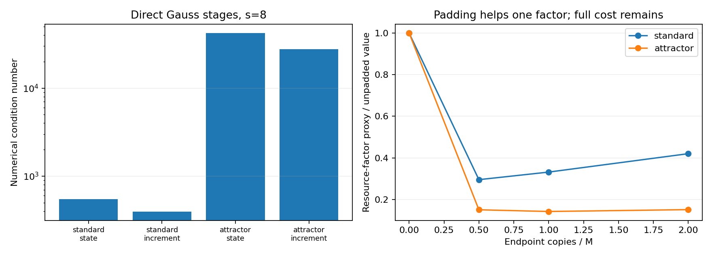

# 完整配点阶段 QLSA：实现、改进与优势检验

**直接保留Gauss阶段的路线已实现，避免了经典预编译传播矩阵；增量变量、末端填充和消去后重新编码也已实际检验。当前仍未建立已知初值Lorenz63、T=5、经典高精度轨道的端到端量子优势。**

这不是所有量子算法无优势的证明。特别是数字编码和迭代改进不能被单次振幅读出复杂度排除。端到端优势目标尚未达到；条件性的资源改善不等于已完成这一目标。

参数沿用既有证书：sigma=10、rho=28、beta为binary64存储8/3的精确有理值。两个初值为(1,1,1)与(-8,8,27)，目标物理向量2范数误差1e-8。数学上精确8/3与程序模型的差异没有隐含纳入证书。

## 1. 完整阶段系统如何避免传播矩阵预计算

仍使用预先给定、可严格认证其线性化余项的预测函数c(t)。物理校正g满足g prime=A(t)g+r(t)，A=Df(c)，r=f(c)-c prime。以已知尺度s0归一化v=g/s0。每个区间保留所有配点值V_ij和端点v_i：

```math
V_{ij}-v_i-h_i\sum_{k=1}^{s}a_{jk}A_{ik}V_{ik}=h_i\sum_{k=1}^{s}a_{jk}r_{ik}/s_0,
v_{i+1}-v_i-h_i\sum_{k=1}^{s}b_kA_{ik}V_{ik}=h_i\sum_{k=1}^{s}b_kr_{ik}/s_0.
B X=d,\qquad\dim B=3M(s+1).
```

构造B只需访问已知的A,r和Gauss系数，不求解阶段方程，也不先计算E_i,d_i。阶段变量另测试增量V_ij-v_i，并以sqrt(b_j)加权。加权是明确的变量／方程变换；缩小历史范数不意味着条件数或block-encoding归一化同步变好。

扫描M基准及翻倍、s=4/8/12、两种阶段变量、两个初值，共24例。20例通过数值末端1e-8筛选，所有失败行保留。矩阵的全局稀疏解与公平的单右端经典逐段解最大相对差为1.84e-14。

| 初值 | M | 阶段变量 | 维数 | 数值kappa | 实现分解alpha | 未填充末端概率 |
|---|---:|---|---:|---:|---:|---:|
| standard | 128 | state | 3456 | 548.82 | 10.12675 | 0.010368 |
| standard | 128 | increment | 3456 | 396.25 | 11.16997 | 0.016664 |
| attractor | 256 | state | 6912 | 42287.53 | 7.53484 | 0.001809 |
| attractor | 256 | increment | 6912 | 27673.62 | 6.79974 | 0.003552 |

这些条件数、末端概率及数值误差是浮点诊断，不能当作严格奇异值界或量子运行结果。数值谱诊断使用的稀疏LU只用于研究，不是给量子算法的免费预条件器。构造阶段系统、编译其block encoding与执行QLSA是不同步骤；本轮未执行完整QLSA。

## 2. alpha有明确的分解和门级实现

对填充到2幂维数的矩阵B（新增维度取单位阵），按循环位移d分解：

```math
B=\sum_d D_dS_d,\quad (D_d)_{ii}=B_{i,i-d\bmod P},
w_d=\max_i|(D_d)_{ii}|,\qquad\alpha=\sum_dw_d.
U=(\mathrm{PREPARE}^{\dagger}\otimes I)\,\mathrm{SELECT}\,(\mathrm{PREPARE}\otimes I),
(\langle0|\otimes I)U(|0\rangle\otimes I)=B/\alpha.
```

PREPARE由二叉旋转树制备sqrt(w_d/alpha)。SELECT使用可逆加常数实现位移，并按稀疏非零条目受控旋转成功旗标，给出带符号的B_ij/w_d。alpha来自这一实际分解；输入浮点矩阵被视作精确有理数，权重总和另存为Fraction。旋转角和门级模拟为有限精度，容错旋转综合、系数舍入对完整QLSA的误差仍需另计。

小规模12维Lorenz系数阶段矩阵填充至16维，实际编译20量子比特、9,100个cx、11,488个u门。全部16列的成功块与B/alpha对比，最大条目差1.11e-16。没有用稠密UnitaryGate或SVD生成量子门。

同一小系统也实际执行了带符号右端态制备和Hadamard干涉读出，成功概率与直接矩阵元计算相差2.22e-16。此处读出的是B/alpha；将其替换成逆矩阵块需要另行实现QLSA，不能将本检验称为已经量子求逆。

当前参考实现采用明确计费的稀疏查表。完整案例保留每个非零条目的加载成本；查表条目数随M线性增长。CSV／JSON中的CX上界只覆盖查表部分，PREPARE、位移、逆线路、旋转综合另计；它是资源上界，不能当作任意实现的资源下界。更快的相干多项式系数计算可能改变此成本，但本轮没有把它假设为免费。

## 3. 已实际检验的预条件与末端改进

**局部块Jacobi。** 编译局部逆对前态三列及右端的作用可略降增量系统条件数，但需要每段3s阶、四右端的求解；经典直接推进只需单右端。相干应用局部逆还需自己的归一化与加载，不能将已经典算出的系数视作廉价量子门。

**零向量场前缀预条件。** 取B0为令A=0的阶段矩阵，P=B0 inverse可由解析前缀求和构造，无需真实传播矩阵。先消去再编码：

```math
PB=I-P(B_0-B).
\alpha_{PB}\le1+\alpha_P\alpha_{B_0-B},\qquad
\alpha_{PB,\mathrm{naive}}\le\alpha_P\alpha_B.
```

扰动含h，故均匀网格、固定T和固定阶段数下可抵消前缀归一化中的M增长；不能只看乘积alpha_P alpha_B便否定该思路。本轮对四个完整阶段案例验证消去恒等式，并比较组合编码与直接重新分解：

| 初值 | 变量 | 组合alpha | 消去后组合alpha | 直接重编码alpha | 重编码alpha × 数值逆范数 |
|---|---|---:|---:|---:|---:|
| standard | state | 4846.67 | 3339.12 | 871.05 | 6.05e+04 |
| standard | increment | 1429.76 | 1251.61 | 1160.57 | 8.31e+04 |
| attractor | state | 7233.16 | 3505.29 | 859.63 | 2.71e+06 |
| attractor | increment | 1740.73 | 1311.92 | 1154.30 | 3.66e+06 |

消去与重编码相对朴素组合有收益，但在这些案例中，未优于原始阶段系统的alpha×逆范数。前缀后的右端状态制备也需计费。结果只针对已实现分解与这些网格，不排除其他预条件器。

**末端填充。** 实际追加y_1=v_M、y_(k+1)=y_k等式，验证解保持不变。填充能明显提高末端联合投影概率，但也改变奇异值和alpha。下面比较alpha×逆范数／sqrt(p)这一数值指标；它不是完整门数：

| 初值 | 填充副本 | 末端联合概率 | alpha × 数值逆范数／sqrt(p) |
|---|---:|---:|---:|
| standard | 0 | 0.016664 | 1.25e+04 |
| standard | 64 | 0.524159 | 3.69e+03 |
| attractor | 0 | 0.003552 | 1.38e+06 |
| attractor | 256 | 0.478078 | 1.96e+05 |

因此不能说填充必然无效；这里它确实改善了一个重要资源因子。不过该收益尚未覆盖状态加载、精度和经典对照的完整成本。

## 4. 直接读逆矩阵元：消除了末端投影，却引入另一归一化

若能实现W的成功块B inverse/(2 beta)，其中beta严格不小于||B inverse||，并能制备|d>=d/||d||，则对末端三个基向量可测带符号矩阵元m_j：

```math
m_j=\langle j|B^{-1}/(2\beta)|d/\|d\|\rangle,
g_j=s_0 X_j=Cm_j,\qquad C=2s_0\beta\|d\|.
p_j=(1+m_j)/2.
Q_{\rm inverse}=O\!\left(\alpha\beta\log\frac{\alpha\beta}{\eta}\right),\qquad
Q_{\rm read}=O\!\left(\frac{C}{\epsilon}\log\frac1\delta\right).
```

这条读出不需要完整解态归一化或末端投影，但C替代了原来的历史概率因子。因p=(1+m)/2，概率误差需按2C换算；代码计入三个坐标、相位分辨率和重复。上述逆多项式阶数为隐藏常数的大O指标，未被写成精确充分门数。实际奇异值给出的beta只是数值估计，不是本轮认证的上界，所以代入后的预算也只能作条件性可行性筛选。

| 初值 | 未填充alpha × 数值逆范数 | 物理读出尺度C | 条件性三坐标QAE调用预算 |
|---|---:|---:|---:|
| standard | 1.61e+03 | 0.000318 | 226,492,389 |
| attractor | 8.22e+04 | 0.000567 | 452,984,805 |

还实际检查了输出特定的伴随行lambda_j=B inverse-transpose e_j。行范数比整体逆范数更小，假设行态免费可用，读出尺度会改善；但通过同一逆块制备该行的放大因子为2 beta/||lambda_j||。在这个具体构造中，两者相乘恰好回到C。三条伴随行的实测范数、尺度和放大次数均保留在tradeoff_padding.csv，未把经典伴随求解当作免费量子输入。

这些调用数不是所有量子读出的下界，也不是完整算法耗时。端到端至少还包括：

```math
C_{\rm Q}=C_{\rm guide}+C_{\rm certificate}+C_{\rm coefficient/RHS\ compile}
+Q_{\rm read}\,[Q_{\rm inverse}(G_B+G_{B^\dagger})+G_{\rm RHS}+G_{\rm reference/reflection}],
C_{\rm classical}=C_{\rm guide}+C_{\rm certificate}+O(Ms^3\mathcal M(b)),
```

其中M(b)是b位乘法成本。经典方使用同一预测器和证书，只逐段解3s阶单右端系统；既不要求稠密全局逆，也不重复证书开销。量子门、经典多精度乘法和Python秒数分别计量，不将其相除宣称速度比。若要输出整条经典轨道，还必须计入相应输出量。

矩阵加载误差也必须进入预算。若beta||Delta B||<1，则解扰动不超过beta(||Delta d||+||Delta B|| ||X||)/(1-beta||Delta B||)。逐项加载误差需结合行列稀疏度转为算子误差；缩放后的误差还需乘回物理尺度。详细推导见[预条件与读出审计](FULLSTAGE_THEORY_NOTES.md)。

## 5. 检查绕过振幅读出的两条路线

**数字编码。** 计算基保存b位坐标时，理想确定性线路可单次测量输出，不存在通用的1/epsilon振幅读出要求。实际编译2/3/4/8/16位乘法器，并对前三个进行态向量验证。该组件说明读出机制可行；完整可逆Lorenz积分尚未实现。把经典Taylor算术可逆化仍继承其计算工作，当前没有获得加速。所有u门计数假定理想连续旋转，容错综合另计。

**迭代改进。** 若有已验证的误差递推：

```math
e_{k+1}\le\theta e_k+Ce_k^2,\quad0<\theta<1,
```

进入收敛邻域后，恒定相对求解精度允许O(log(1/epsilon))轮，而非单次把粗余项绝对读到epsilon。它是值得保留的可能性，不能被单次QAE标度否定。但全时间Newton改进通常要更新整条预测函数的系数；只提取三个末端量不能自动完成下一轮相干oracle。相同热启动及预处理也必须给经典迭代算法。

作为进一步公平对照，直接经典Taylor在T=5、100步、100位算术下扫描16个案例：

| Taylor阶数 | standard实测末端误差 | attractor实测末端误差 | 二次卷积乘法 |
|---|---:|---:|---:|
| 32 | 7.855e-12 | 3.406e-13 | 105,600 |
| 64 | 1.856e-25 | 7.891e-30 | 416,000 |
| 96 | 4.757e-39 | 2.219e-45 | 931,200 |

上表不是严格误差界。参考采用不同步长、阶数和精度交叉比较，交叉差另存；算术计数另含线性乘法、小整数除法及求值。固定T与维数、具有统一局部解析半径时，经典高阶算法本来就有对1/epsilon多对数的精度标度。量子算法需对比这一基线，不能只对比固定低阶积分或Monte Carlo。

量子谱法、Newton与multigrid的原始文献和输出／数据访问条件见[alternative_summary.json](results/fullstage_qlsa/alternative_summary.json)。它们没有自动提供本任务的经典三坐标加速。

## 6. 严格保证与未完成的目标

本轮明确区分：既有线性化证书的严格余项；新阶段系统的数值精度和奇异值；小规模原生门的浮点模拟；以及条件性的QLSA资源公式。任一数值指标的改善都不直接等于端到端量子优势。

另对阶段数据重构的连续多项式G进行严格后验认证：浮点节点与阶段值视作精确输入，将最终系数量化到256个二进制小数位，并强制各区间端点连续。量化误差与阶段求解误差都通过精确残差重新检查：

```math
D=G^{\prime}-A G-r,\qquad
\|u-(c+G)\|_{\infty,2}\le E_{\rm nonlinear}+K\|D\|_{\infty,2}.
```

这里G(0)=0，各段连续；这两个条件均由精确运算检查。残差使用精确有理运算和Bernstein凸包界，必要时用de Casteljau细分；没有把真实参考轨道的实测误差用于认证。K与非线性余项来自同一预测函数的旧证书，重放命令会验证源证书哈希并重新验证其证明。

| 初值 | M | 阶段数 | Bernstein细分 | 全[0,5]严格误差上界近似显示 | 通过1e-8 |
|---|---:|---:|---:|---:|---|
| standard | 128 | 8 | 1 | 4.500165e-04 | False |
| standard | 128 | 12 | 1 | 2.492615e-08 | False |
| standard | 128 | 12 | 4 | 5.710184e-10 | True |
| attractor | 256 | 8 | 1 | 2.897180e-04 | False |
| attractor | 256 | 12 | 1 | 3.842641e-09 | True |

证书控制的是明确的连续有理多项式；末端转浮点的舍入界另存。未通过的上界不代表实际误差一定超标。特别是Gauss末端超收敛与低阶连续内插的全区间残差界不同；两者不能混用。

**上述两条通过轨道已在经典侧构造出来。** 它们不能算量子运行结果或免费量子预处理。若要认证精确阶段系统及QLSA返回值，还需证明其与所认证多项式的距离，并加入矩阵加载、求逆与读出误差；本轮没有跳过这些步骤来宣称量子优势。

当前没有同任务优势方法可报告。还缺少同时满足以下条件的构造：廉价相干系数与右端访问、有效且可应用的预条件、可认证线性求解精度，以及比同精度经典算法更低的总成本。对数字编码或多轮改进，困难是找到低于经典直接计算的量子工作量，而非仅减少测量次数。

## 7. 复现

```bash
OPENBLAS_NUM_THREADS=1 python fullstage_system.py
OPENBLAS_NUM_THREADS=1 python fullstage_encoding.py
OPENBLAS_NUM_THREADS=1 python fullstage_tradeoffs.py
OPENBLAS_NUM_THREADS=1 python alternative_precision_audit.py
OPENBLAS_NUM_THREADS=1 python fullstage_certificate.py
OPENBLAS_NUM_THREADS=1 python fullstage_certificate.py --verify --verify-source
OPENBLAS_NUM_THREADS=1 python -m unittest discover -v
python write_fullstage_report.py
```

[完整阶段代码](fullstage_system.py) · [block encoding](fullstage_encoding.py) · [预条件／读出](fullstage_tradeoffs.py) · [数字编码与精度](alternative_precision_audit.py) · [全部数据](results/fullstage_qlsa/)


