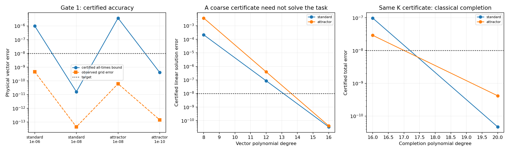

# 全局线性缺陷校正：两个门槛的验证

**门槛1通过：对标准参数、T=5、目标1e-8，两个初值均获得全区间严格误差证书。门槛2未通过：当前流程没有展示端到端量子优势。**

本轮不仅计算参考轨道上的数值变分放大，而是验证整个已知系数线性方程的传播、强迫及舍入误差。认证不调用真实非线性参考轨道，不使用采样的 K 或最大 Lyapunov 指数。完整代码和证书保存在仓库，可独立重放。

## 1. 被验证的问题与精度范围

模型仍为 Lorenz63，sigma=10、rho=28、beta=程序存储的 binary64 8/3 的精确有理值。初值 standard=(1,1,1)，attractor=(-8,8,27)。时间0到5连续全区间，目标物理向量2范数误差1e-8。预测轨道由 DOP853 的浮点节点定义，但其精度不被直接当作保证：节点视作精确有理数据，再精确构造匹配0至3阶导数的分段七次 Hermite 多项式 c(t)。

令 e=u-c，A(t)=Df(c(t))，r=f(c)-c prime，则有精确误差方程：

```math
e'=A(t)e+r(t)+Q(e),\qquad Q(e)=(0,-e_xe_z,e_xe_y)^T,\qquad e(0)=0.
\|Q(e)\|_2\le\tfrac12\|e\|_2^2,\qquad\|DQ(e)\|_2=\|e\|_2.
```

线性校正 g 满足 g prime=A g+r，g(0)=0。为避免数值计算 r=f(c)-c prime 时的相消，实际验证 v=c+g 的等价线性方程：

```math
v'=A(t)v+b(t),\qquad b(t)=f(c(t))-A(t)c(t)=(0,c_xc_z,-c_xc_y)^T,\qquad v(0)=u_0.
```

这个变换没有引入高阶 Carleman 截断，也没有演化 Gaussian 分布。c(t) 在量子工作之前给定，因此整个线性校正过程不需要从量子中间态测量更新中心。

若 G 为零初值线性强迫响应算子，K>=||G||_(infinity,2 -> infinity,2)，a>=||g||_(infinity,2)，并且2Ka<1，则：

```math
R=\frac{2a}{1+\sqrt{1-2Ka}},\qquad
\|u-v\|_{\infty,2}\le\frac K2R^2.
```

代码对平方根向下包络，使计算出的 R 向上，并再次以精确有理数检查 a+KR^2/2<=R 及 KR<1。若数值多项式 V 对精确线性解 v 的误差界为 eta，则返回的经典近似有全区间误差<=KR^2/2+eta。

## 2. K 和 a 怎样严格验证

每个预测区间再细分到长度<=.02，取局部时间 tau in [0,1]。矩阵 B(tau)=h A(t) 是已知七次多项式，强迫 d(tau)=h b(t) 至多十四次。传播子 F 和向量 V 分别构造有限次幂级数。

计算采用512个二进制小数位的定点整数（另有整数位）。矩阵／向量系数先向下取到网格，生成多项式后，直接检查残差：

```math
\mathcal R_F=F'-BF,\qquad\mathcal R_V=V'-BV-d.
```

残差的中心乘积在2^(1024)尺度以整数精确计算，并补上系数加载误差。该检查同时覆盖级数截断和构造舍入，不需要猜测幂级数尾的大小。若 q>=exp(sup||B||infinity)，则局部全区间误差<=q integral_0^1||R(tau)||infinity d tau。q 本身也以正项级数和几何尾作整数外向包络。

对 E_i=Phi(t_(i+1),t_i)，保存带符号的近似矩阵与严格误差半径。跨区间先进行实际矩阵乘法，再取范数，并传播乘法舍入半径；没有把整体传播替换成逐步范数的乘积。后者只在极小的不确定性半径传播中使用。

对端点 t_j，有：

```math
K_{j,\infty}\le\sum_{i<j}h_iq_i\|\Phi(t_j,t_{i+1})\|_\infty,
K_{\infty}\le\max_j q_j(K_{j,\infty}+h_j),\qquad K_2\le\sqrt3 K_\infty.
```

第二行覆盖区间内部任意时刻；这不是只验证终端敏感性。向量误差以相同传播矩阵的带符号乘积界传播。

对 V-c 的每个分量，使用 Bernstein 系数凸包加高阶绝对尾，验证整个 tau 区间上的大小，再加入线性解的不确定性，得到 a。所有 Bernstein 变换都用整数上下舍入；单靠网格点检查不足以得到这个保证。

## 3. 门槛1：实际结果

下表科学记数为近似展示，完整外向小数及精确有理上界见证书。总界包含全区间线性多项式误差、非线性校正余项，以及精确求值后转 binary64 的统一舍入界。

| 初值 | 预测rtol | K严格上界 | a严格上界 | 总误差严格上界 | 通过1e-8 |
|---|---:|---:|---:|---:|---|
| standard | 1e-06 | 57.552 | 1.8624e-04 | 1.0090e-06 | False |
| standard | 1e-08 | 52.639 | 7.8617e-07 | 1.6287e-11 | True |
| attractor | 1e-08 | 3800.2 | 4.0820e-05 | 3.7795e-06 | False |
| attractor | 1e-10 | 3910.9 | 4.5939e-07 | 4.1344e-10 | True |

**两个较细预测通过，两个较粗预测没有通过。** 较粗预测的校正实测误差可能已经小于目标，但不能据此跳过严格界。本轮没有把这些失败行隐藏或当成数学认证。

也验证了预测轨道本身没有先达到目标：通过案例的预测末端误差严格下界分别超过2.19e-7和1.03e-7，均大于1e-8。下界由已认证校正多项式与预测端点的距离减去校正误差界得到，不依赖参考轨道。

通过证书控制的是精确的分段多项式近似 V(t)。`evaluate` 先以 Fraction 对指定时刻求值，再转浮点，并返回舍入界。普通 NumPy Horner 网格求值只用于观察图表，不能冒充该认证接口。

本轮也发现双精度 DOP853 参考在很小误差处可能比待验证的界更不准确，因此单元测试改用独立高精度原非线性方程积分检查；这个参考仍不参与证书的成立。

## 4. 防止过度认证把经典答案提前算完

基准认证用80阶向量多项式，确实已经计算出了满足目标的经典解。仅据此否定量子路线会遗漏“低精度证书”的可能性，所以额外保留传播矩阵80阶，单独将向量阶数降低到8、12、16。

| 初值 | 向量阶数 | 线性解误差eta上界 | 二次余项上界 | 理想线性化余项合格 | 经典多项式已达目标 |
|---|---:|---:|---:|---|---|
| standard | 8 | 2.131e-04 | 1.309e-06 | False | False |
| standard | 12 | 8.659e-08 | 1.639e-11 | True | False |
| standard | 16 | 3.467e-11 | 1.633e-11 | True | True |
| attractor | 8 | 3.689e-03 | 未满足压缩条件 | False | False |
| attractor | 12 | 3.953e-07 | 1.346e-09 | True | False |
| attractor | 16 | 4.154e-11 | 4.135e-10 | True | True |

**12阶证书是重要的对照：它足以保证原非线性解靠近精确线性校正解，但它构造的经典校正多项式还不能被认证为达到1e-8。** 所以“获取 K,a 必然已经算出了最终答案”并不成立。门槛2必须继续比较，而不能到这里就结束。

## 5. 门槛2：与同一证书下的经典补算比较

对12阶证书，复用已经认证的 K，只重新计算3分量的20阶线性多项式。没有重复传播矩阵级数，也没有重复全时间矩阵乘积。使用新多项式的全局残差 D(t)=V prime-A V-b，得到：

```math
\|v-V\|_{\infty,2}\le K\|D\|_{\infty,2}\le\sqrt3 K\max_i\frac{p+8}{h_i}\sum_k\frac{\|\mathcal R_{i,k}\|_\infty}{k+1}.
```

这个较便宜的残差界比精细传播更松，所以16阶补算未通过，20阶通过。所有额外整数乘法（包括少量未用于传播的恒等矩阵残差检查）均计入。

| 初值 | 补算阶数 | 严格总误差 | 通过1e-8 | 额外定点乘法 | 本机额外经典秒数 |
|---|---:|---:|---|---:|---:|
| standard | 16 | 9.816e-08 | False | 699,660 | 1.208 |
| standard | 20 | 4.684e-11 | True | 871,884 | 1.287 |
| attractor | 16 | 2.920e-08 | False | 814,320 | 1.400 |
| attractor | 20 | 4.170e-10 | True | 1,014,768 | 1.437 |

计时只是本机 Python 实现一次运行，不是对优化经典算法的性能下界，也不与未知量子门时长作速度比。预测、系数转换、K/a认证的工作对两条路线共同存在；经典补算只需在这份共同工作上增加表中成本。

### 条件性的量子末端读出预算

令 s=a 的认证上界，假设能制备归一化的四分量末端态 z=(1,g/s)。p0>=1/2，三个相干观测量 m_j 给出 g_j=s*m_j/(2*p0)。需估计三个相干量及p0，共四类观测。若可用的剩余误差预算为 epsilon_r，选：

```math
\delta=\min\{1/8,\epsilon_r/(24\sqrt3s)\},\qquad
\zeta=\min\{1/64,\epsilon_r/(32\sqrt3s)\}.
```

delta 是每个观测量的误差，zeta 是量子末端态制备的2范数误差。因期望值误差<=2*zeta，估计后的分母仍>=1/4，读出物理向量误差<=6*sqrt3*s*(delta+2*zeta)<=5*epsilon_r/8。选择 canonical QAE 的2幂分辨率和精确二项尾中位数重复，使四次估计总失败概率<=.05。

对两份12阶证书，这一具体QAE构造均需 **5,767,124 次末端态制备或逆制备调用**。这不是任何量子读出的下界，也不代表一个调用只需一个基本门；它是把末端态制备视为oracle后的充分预算。

相比之下，复用同一K证书的20阶经典补算约需87万、101万次定点乘法（512个小数位），并已给出严格精度保证。**不同单位不能相除称为速度比。** 当前证据没有支持量子端到端加速；尚需一个实际可实现且足够便宜的量子线性求解器才能作更强的正面判断。

### 系数访问和线性求解没有免费处理

归一化误差方程的矩阵为 [[0,0],[r/s,A]]。小的 s 能降低物理读出因子，但会提高 r/s 的系数。代码对每个预测区间展开矩阵单位和 tau^k 的系数 LCU，记录非零项总数、精确系数位数，以及 max_interval sum|coefficient| 的归一化。它来自明确分解，不能被数值谱范数直接替换。

| 通过的基准案例 | 非零系数项总数 | 此系数LCU的alpha上界 | 最大精确系数位数 |
|---|---:|---:|---:|
| standard | 6,498 | 1.1987e+06 | 741 |
| attractor | 15,405 | 1.2583e+04 | 737 |

这些alpha较保守，换成有实际实现的分解可能更好；它们不是不可降低的复杂度下界。精确系数位数表示有理输入的储存长度，不是量子实现必须保留这些位数的下界。当前没有实现高效的相干区间查找、系数加载／时间幂编码和完整QLSA，因此没有将它们的成本填成0，也没有把本轮条件性预算称为已经运行的量子算法。

端到端比较的结构为：

```math
C_{\rm classical}=C_{\rm guide}+C_{K,a}+C_{\rm completion},
C_{\rm hybrid,classical}=C_{\rm guide}+C_{K,a}+C_{\rm oracle\ compile},
G_{\rm quantum}=Q_{\rm readout}(G_{\rm endpoint\ prep}+G_{\rm reflection})+G_{\rm phase\ estimation}.
```

经典算术与量子门分别计量。使用80阶完整证书时，答案已经在经典侧，量子补算确实冗余；使用12阶粗证书时，答案尚未达到认证精度，但已有经过验证的廉价经典完成路线。后者是本轮公平成本判断的主要依据，不是以过度预计算人为排除量子方案。

### 固定T下的精度标度

还有一个针对当前流程的理论判断：若固定T、初值与参数，局部解析半径有统一正下界，高阶经典Taylor积分可用随log(1/epsilon)增长的阶数及位数完成三维求解。卷积和位算术总成本对1/epsilon是多对数；有限时间放大只进入常数或额外位数。
若本方案把粗误差选在a与sqrt(epsilon)同阶，使二次余项达到epsilon，则当前通用QAE读出规则的调用数仍与a/epsilon同阶，即epsilon^(-1/2)，再乘制备成本。因此这个具体流程没有获得优于该经典基线的渐近精度标度。若将a压至epsilon量级以消除读出惩罚，则必须检查经典预测是否已经可以停止。这不是对所有量子算法的精度下界，也不涉及大规模初值集合或高维系统的优势。

## 6. 直接经典积分基线及结论范围

另扫描DOP853 rtol=1e-6/1e-8/1e-10/1e-12/1e-13，在.001网格对既有高精度参考比较。这里是经验精度检查，不是区间认证。共同证书加经典补算才是本轮有严格同精度保证的经典替代。

| 初值 | 扫描中达到实测1e-8的最少RHS调用 | rtol | 实测最大误差 |
|---|---:|---:|---:|
| standard | 4,703 | 1e-12 | 1.309e-10 |
| attractor | 6,602 | 1e-12 | 3.047e-09 |

**最终判断：线性化精度门槛通过，量子优势门槛未通过。** 这不是对所有Lorenz量子算法的不可能性定理；当前没有量子硬件计时，也没有假装已经运行完整QLSA。若继续研究量子优势，下一步必须提供具体的低成本相干线性求解和系数访问实现，并与本轮已认证的经典补算比较，而不能只凭无中间测量或较小校正量宣称优势。

## 7. 复现、证书与测试

```bash
OPENBLAS_NUM_THREADS=1 python global_correction_study.py
OPENBLAS_NUM_THREADS=1 python global_correction_study.py --precision-study
OPENBLAS_NUM_THREADS=1 python global_correction_study.py --completion-study
OPENBLAS_NUM_THREADS=1 python verify_global_correction.py
OPENBLAS_NUM_THREADS=1 python -m unittest discover -v
python write_global_correction_report.py
```

首次主实验可快速检查：`python global_correction_study.py --quick --out /tmp/global_smoke`。完整重放仅读取预测节点、配置和证书，不运行参考非线性求解器。4份主证书、6份精度对照、4份经典补算共14份；补算证书通过哈希绑定其继承的12阶传播证书。

文件：

- [global_correction.py](global_correction.py)：有理预测、多项式残差、带符号传播、全区间包络和经典补算。
- [global_correction_study.py](global_correction_study.py)：两个门槛、低精度证书对照、经典成本和条件性QAE预算。
- [verify_global_correction.py](verify_global_correction.py)：独立重放，不调用非线性参考轨道。
- [results/global_correction](results/global_correction/)：完整CSV、精确证书、观测数据和门槛判断。


