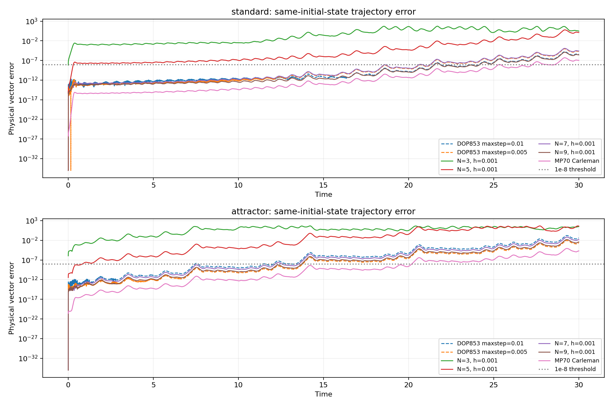
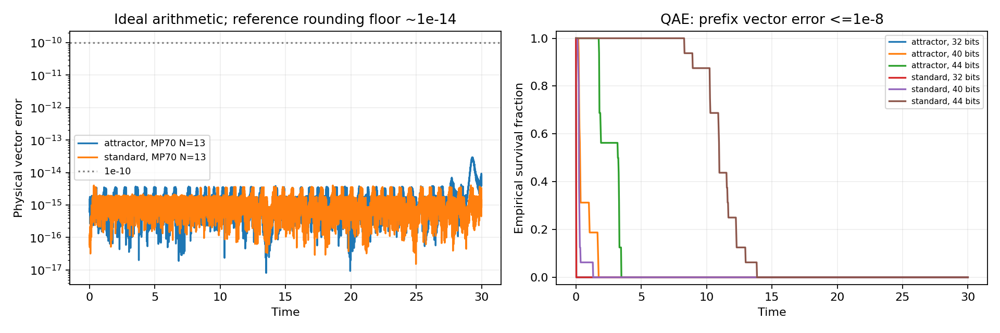
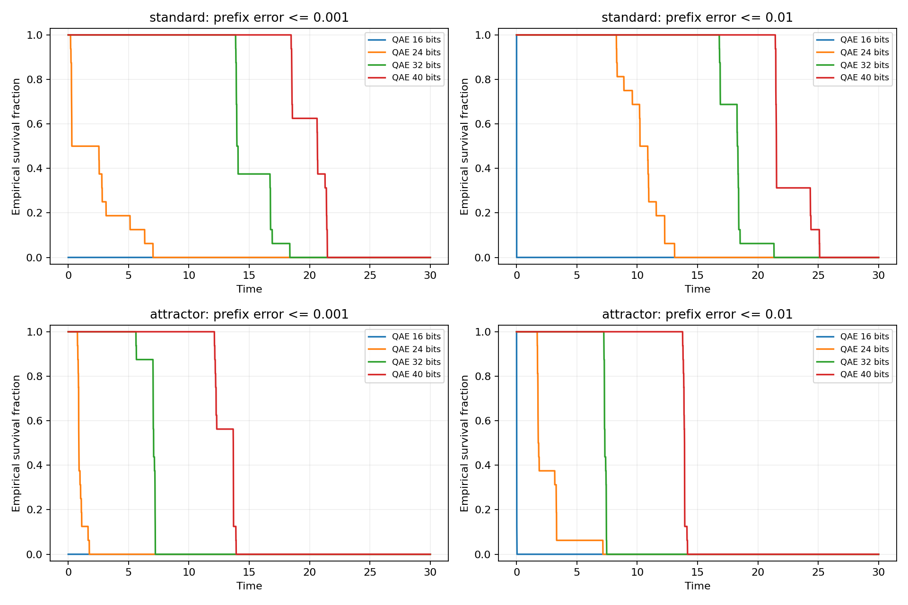

# 长时间同初值轨道高精度验证

本报告由 `write_longtime_report.py` 从原始数据生成。目标是同一个初值的逐时刻轨道误差，不用统计量或 shadowing 替代。所有时间均为 Lorenz 无量纲时间。

测试到 T=30，参考采样间隔 0.001。两组初值为 `(1,1,1)`（standard）和 `(-8,8,27)`（attractor）。后者直接接近吸引子，避免只依赖标准初值的初始过渡段。

**结论范围：数值交叉验证，不是区间算术认证或量子硬件实验。有限路径的比例不是严格成功概率保证。**

## 复现

```bash
python -m pip install -r requirements.txt
OPENBLAS_NUM_THREADS=1 python -m unittest -v test_validation.py test_long_validation.py
OPENBLAS_NUM_THREADS=1 python long_validation.py --horizon 30 --paths 16
OPENBLAS_NUM_THREADS=1 python precision_extension.py --paths 16
python write_longtime_report.py
```

快速检查可先运行：

```bash
OPENBLAS_NUM_THREADS=1 python long_validation.py --quick --horizon 0.1 --paths 4 --out smoke_results
```

完整实验比原单步实验更耗时。`precision_extension.py` 会复用已完成的每初值扩展检查点；更改模型、算法或实验设置后应删除相应 `results/longtime/extension_state.json` 和缓存再重跑。高精度扩展的时间范围应为 0.002 的整数倍。

## 1. 高精度参考解本身的检查

参考方法是直接对原三维 ODE 计算局部时间 Taylor 系数，包含多项式卷积，并在段内作高精度求值。没有使用 Carleman 作为参考，以免与被测方法共享同一种截断误差。

- 第一组：70 位十进制精度，局部时间多项式次数 50，分段长度 0.01。
- 第二组：90 位十进制精度，次数 60，分段长度减半为 0.005。
- 两组在全部 0.001 间隔采样点比较。提高精度、次数和减半步长是数值证据，不是严格余项包络。
- 参数按现有程序存储的 binary64 值精确转成任意精度数；特别是 beta 使用 `float(8/3)` 的精确数值，未悄悄改成数学上的精确有理数 8/3。这样比较的是同一个数值模型。

| 初值 | 两组参考解的全程最大差 |
|---|---:|
| standard | 1.056850601184784669362466e-49 |
| attractor | 9.998527719350070386714593e-51 |

原始数据：`reference_checks.json`；浮点存储的参考轨道：`reference_standard.npz`、`reference_attractor.npz`。

## 2. 理想 relifted Carleman 的长期误差

在完整时间网格上检查物理三维向量误差和首次越界时间，不只比较终点。固定中心和 S=64；每次重新计算完整单项式提升。只传播三个目标行并采用增量更新；这仍是同一个截断 Carleman 一步映射。

| 初值 | 算术 | N | h | 全程最大误差 | 首次超过 1e-8 | 首次超过 1e-6 |
|---|---|---:|---:|---:|---:|---:|
| standard | binary64 | 3 | 0.001 | 5.2620e+01 | 0.002 | 0.074 |
| standard | binary64 | 5 | 0.001 | 6.1486e+00 | 0.302 | 13.061 |
| standard | binary64 | 7 | 0.001 | 1.1996e-04 | 20.661 | 25.179 |
| standard | binary64 | 9 | 0.001 | 1.2482e-05 | 21.535 | 27.466 |
| standard | mp70 | 9 | 0.002 | 4.9299e-07 | 27.288 | 未越界 |
| attractor | binary64 | 3 | 0.001 | 4.5379e+01 | 0.001 | 0.001 |
| attractor | binary64 | 5 | 0.001 | 4.5125e+01 | 0.836 | 3.317 |
| attractor | binary64 | 7 | 0.001 | 6.4285e-02 | 12.168 | 14.038 |
| attractor | binary64 | 9 | 0.001 | 1.5443e-02 | 13.719 | 19.459 |
| attractor | mp70 | 9 | 0.002 | 8.4097e-05 | 20.19 | 26.034 |

完整阶数／步长扫描以及双精度 DOP853 的参考误差见 `deterministic.csv`。高阶双精度方法可能进入舍入误差限制区，继续提高阶数或减小步长并不保证长期误差单调减小。



## 3. 更高阶的任意精度扩展

使用 70 位运算、N=13、h=0.002。Carleman 传播的三个增量行用稀疏任意精度 Taylor 递推构造，算子尾界目标 1e-65；没有先将双精度 C_N 转成高精度来假装恢复丢失的系数。

这部分为复用缓存，使用 90 位参考解转换成 binary64 的坐标进行比较；误差接近约 1e-14 时受参考存储格式限制，不能将其解释为已经验证 14 位以上精度。

| 初值 | 全程最大差 | 参考存储舍入尺度估计 | 首次超过 1e-10 | 首次超过 1e-8 |
|---|---:|---:|---:|---:|
| attractor | 2.9625e-14 | 1.740e-14 | 未越界 | 未越界 |
| standard | 4.0465e-15 | 1.840e-14 | 未越界 | 未越界 |

**这验证的是理想高精度算术下的轨道，不是已经包含有限量子读出的轨道。** 实现同样的量子门／系数精度还需重新核算。

## 4. 有限 QAE 的高精度窗口

有限读出采用 N=9、h=0.001 的 binary64 概率模型，每个设置 16 条独立路径，每坐标 QAE 重复 7 次取中位数。比较 24、32、40、44 位相位寄存器。高精度窗口实验在路径首次超过 1e-6 后停止；因此更严格的 1e-8、1e-6 首次越界仍可准确记录，不会因终点回落而误判恢复精度。

以下为样本首次越界时间的中位数。未越界的路径作右删失处理，不把实验终点当成真实失效时间；这些中位数不构成可靠性保证。

| 初值 | QAE 相位位数 | 首次超过 1e-8 的中位时间 | 首次超过 1e-6 的中位时间 |
|---|---:|---:|---:|
| standard | 24 | 0.001 | 0.001 |
| standard | 32 | 0.001 | 0.1385 |
| standard | 40 | 0.231 | 13.055 |
| standard | 44 | 10.9585 | 16.758 |
| attractor | 24 | 0.001 | 0.001 |
| attractor | 32 | 0.001 | 0.276 |
| attractor | 40 | 0.306 | 5.5625 |
| attractor | 44 | 3.231 | 7.1755 |

较宽松 1e-3、1e-2 阈值下的全程存活比例见 `qae_survival.csv`。原始逐路径高精度首次越界记录见 `high_precision_qae_exits.csv`。





## 5. 运行次数不能隐藏

本实验模拟 canonical QAE 的完整离散概率分布，不用高斯噪声代替。为避免构造 2^b 长度的分布，使用 QPE 核的精确拒绝采样（下面说明）。这个经典模拟优化没有降低量子算法的查询数。

相位位数 b、M=2^b、重复 7 次时，每坐标每步制备／逆制备调用数仍是 `7*(2*M-1)`。三个坐标、一条完整轨道的次数如下，使用第一组初值对应设置（两组的 K 相同）：

| 相位位数 | 每坐标每步 A/A† 调用 | 一条完整轨道 A/A† 调用 | 一条完整轨道基础 block 调用 |
|---|---:|---:|---:|
| 24 | 234,881,017 | 21,139,291,530,000 | 317,089,372,950,000 |
| 32 | 60,129,542,137 | 5,411,658,792,330,000 | 81,174,881,884,950,000 |
| 40 | 15,393,162,788,857 | 1,385,384,650,997,130,000 | 20,780,769,764,956,950,000 |
| 44 | 246,290,604,621,817 | 22,166,154,415,963,530,000 | 332,492,316,239,452,950,000 |

此表按完整 T 的路径计费；实际模拟会在越界后提前停止，已执行的路径步数另存于资源 CSV。16 条样本路径是统计验证的独立重复，若硬件上全部运行，还需相应增加总成本。表中没有门综合、纠错、经典反馈和输入制备的额外基本门时间。

## 6. 精确 QAE 分布的高效经典采样

canonical QAE 是两个 QPE 本征相位 `+/-asin(sqrt(p))/pi` 的等权混合。对其中一个相位 phi，令 z=M*phi，j 为最近整数，delta=z-j，输出格点相对 j 的整数偏移为 n。其 QPE 概率核为：

```math
P(k)=\left[\frac{\sin(\pi d)}{M\sin(\pi d/M)}\right]^2,
\qquad d=\operatorname{wrap}(n-\delta).
```

在 n=0 时以 1 为包络，在非零 n 时可用 1/n^2 包络。取离散 Zipf(2) 尾分布与零点混合，包络总质量为 `1+pi^2/3`，再拒绝不在有效循环范围内的偏移并按概率核接受。理论平均候选数为常数量级。代码用普通双精度实现，相位位数限制到 44；不是任意精度概率模拟器。

测试将其小 M 分布与原 FFT 版 QAE 分布比较，并检查端点、高分辨率和多项式传播。这里已知 p 是由经典模拟计算的，因此不能将这个采样器视为解决未知量子振幅估计的经典捷径。

## 7. 哪些尚未保证

- 参考解只有任意精度收敛检查，没有区间 Taylor 余项包络。
- 结果针对指定初值、参数、阶数、步长和时间网格，不是所有初值／连续时刻的统一误差定理。
- 高精度理想传播和有限 QAE 是分开的基线。不能把前者的精度写成量子线路已经达到的精度。
- QAE 检验没有硬件门噪声、门综合误差或纠错开销；固定 7 次中位数重复没有按全部时间步分配严格失败概率。
- 16 条路径的存活比例和首次越界中位数都不是 95% 成功保证。
- 此处不存在已证明的量子优势；高相位精度对应的查询预算非常大。

进一步认证应使用带余项包络的参考积分、数值轨道的局部残差与传播界，再按目标 T 和 epsilon 反推各步读出精度、实现精度与失败概率预算。
