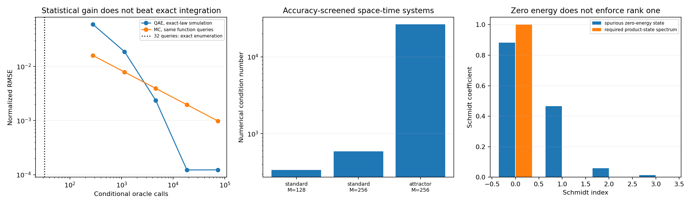

# 新量子算法候选：检验与适用边界

后续更新：[完整配点阶段QLSA](FULLSTAGE_QLSA.md)已实现本报告保留的直接阶段系统，并增加严格连续多项式证书。本报告中“未实现完整阶段系统”等表述记录本轮候选搜索时的状态。

**本轮保持 Lorenz63、已知初值、T=5、经典高精度轨道输出的任务，没有改成高维系统或集合统计。检验了三类新的候选：量子残差积分、全时间量子线性求解、有效 Hamiltonian 基态求解。尚未建立同任务的端到端量子优势。**

有一个正面但有限的结果：条件性均值 oracle 实验确实显示了 QAE 相对 Monte Carlo 的查询收益；换回已知多项式 Lorenz，优化后的确定性经典方法更便宜。下面分别保留正面结果、正确性失败和资源限制。

参数约定沿用全局证书：sigma=10、rho=28，beta取程序存储的binary64数8/3的精确有理值；严格代数与误差界针对这一模型。初值为(1,1,1)与(-8,8,27)，局部h取文中十进制有理数。数学上精确beta=8/3与此模型的差异若需认证，应另计参数扰动，不能隐含忽略。

## 1. 量子残差积分：有优势定理，需检查 oracle 模型

[Kacewicz 的非线性初值算法](https://arxiv.org/abs/quant-ph/0510045)将局部高阶预测后的积分交给量子均值估计。在有限光滑度 q 的函数黑盒类中，量子查询复杂度可改善经典确定性点查询的精度指数，近似从 epsilon^(-1/q) 改为 epsilon^(-1/(q+1))，另有定理中的任意小指数松弛及对数因子。该结论依赖信息访问模型；允许更强的经典线性信息时比较会改变。

本轮测试该思路的局部 Taylor/Picard 残差积分变体，不声称复现完整递归最优算法。令 P_p 为 p阶预测，使用 tau=t/h：

```math
R_j(\tau)=h f_j(P_p(h\tau))-\frac{d}{d\tau}P_{p,j}(h\tau),
\widetilde u(h)=P_p(h)+\int_0^1R(\tau)\,d\tau.
```

对 Lorenz 二次向量场，R 是至多2p次的**已知多项式**。因此：

```math
\int_0^1R_j(\tau)\,d\tau=\sum_{k=0}^{2p}\frac{r_{jk}}{k+1}.
```

经典直接积分已有系数即可得到精确有理值；或者在理想算术下用 p+1 个 Gauss 点精确积分。生成两个二次卷积只需2(p+1)^2次标量乘法。不能把它与只会 Monte Carlo 的经典算法比较后，宣布原问题具有优势。

扫描两个初值、h=.001/.005/.01、p=2/3/4/6/8/12 和三个精度目标，共36组局部数学检验、108个资源条目。Picard近似的局部全区间误差用验证盒、Bernstein范围、Jacobian界及精确指数包络控制；不是用参考解误差作为保证。这些局部证书不构成T=5量子轨道证书。

| 初值 | h | p | 局部目标 | Picard严格界近似显示 | QAE充分A调用 | 经典精确Gauss点数 |
|---|---:|---:|---:|---:|---:|---:|
| standard | 0.001 | 2 | 1e-06 | 4.264e-08 | 14,085 | 3 |
| attractor | 0.001 | 2 | 1e-06 | 1.951e-07 | 128,997 | 3 |
| attractor | 0.001 | 3 | 1e-08 | 1.586e-09 | 147,429 | 4 |
| attractor | 0.001 | 4 | 1e-10 | 1.231e-11 | 147,429 | 5 |
| attractor | 0.005 | 4 | 1e-06 | 1.966e-07 | 64,485 | 5 |

表中只列“经典原预测未被认证可停止、且校正预算可行”的条目；其余原始行全部保留。QAE计入三个坐标、中位数重复和中点求积偏差预算。A/A†调用是逻辑oracle计量；其内部的函数计算、受控旋转、反计算及门数需另计，不能与经典算术次数直接作运行时间比。严格上界采用证书有理值及外向小数；表中科学记数仅为近似展示。

### 一个实际搭建的量子均值 oracle

对 p=4,h=.01 的y残差搭建32点查表式 oracle：14个逻辑量子比特，编译到 2,368 个cx、3,010 个u门。态向量模拟的成功概率与精确有限均值差 1.39e-16。这只是明确可实现的参考oracle：其生成已花费32次经典函数求值，整张表本身就决定均值，不能声称免费加载。

基于该成功概率，进一步精确模拟 canonical QAE 的离散输出分布与9次中位数；不是用Gaussian测量噪声替代。Monte Carlo 用同样函数值的实际方差，按相同oracle调用数比较：

| QAE相位位数 | A/A†调用 | QAE归一化RMSE | MC归一化RMSE |
|---|---:|---:|---:|
| 4 | 279 | 5.988e-02 | 1.594e-02 |
| 6 | 1,143 | 1.875e-02 | 7.873e-03 |
| 8 | 4,599 | 2.357e-03 | 3.925e-03 |
| 10 | 18,423 | 1.223e-04 | 1.961e-03 |
| 12 | 73,719 | 1.227e-04 | 9.803e-04 |

**部分行有真实的条件性查询收益，但不是Lorenz端到端优势。** 确定性枚举只要32个函数值；连续积分还可以直接对已知系数求和。连续积分的RMSE另含中点偏差，不能仅看相位分辨率。该查询实验没有计算量子硬件运行时间，也没有运行全局量子ODE。

## 2. 全时间QLSA：先过滤离散误差，再看条件数

沿用先前已认证的两条预测函数 c(t)，将线性校正 g prime=A(t)g+r(t) 编成全时间线性系统。测试：隐式中点、其代数等价的前缀预条件、Volterra梯形离散、四阶Gauss，以及保留预测分段边界的十六阶Gauss。共35个数值案例。

低阶或未对齐网格的32个案例没有达到末端1e-8，不能拿它们声称同精度加速。高阶对齐对照的三个案例在数值上达到目标：

| 初值 | 时间区间数M | 全局维数 | 数值条件数 | 未填充历史的末端概率 | 数值差＋既有非线性界筛选 |
|---|---:|---:|---:|---:|---:|
| standard | 128 | 384 | 337.3 | 0.02294 | 1.627e-11 |
| standard | 256 | 768 | 590.6 | 0.01087 | 1.627e-11 |
| attractor | 256 | 768 | 2.652e+04 | 0.003614 | 4.134e-10 |

这些是**数值筛选，不是新离散算法的区间误差证书**。本节实际运行的是经典空间时间矩阵及SVD诊断，没有构建或执行QLSA线路。参考使用同一预测函数的高精度已认证线性多项式端点，舍入及非线性余项单列。极小数值差接近参考舍入层，不能据此声称1e-15的严格精度。

高阶编译型时间系统需要每段求解24×24阶段方程、4个右端列，生成传播 E_i 和强迫 d_i。公平的经典直接法每段仅需相同阶段方程的1个右端列，按时间推进即可输出结果；不能要求经典做稠密全局逆。生成 E_i,d_i 后，经典前向传播同样是O(M)。这些预处理均在CSV中计入。

前缀预条件在测试中使条件数变差，也提高了数值范数主控量。该结果不排除更好的预条件器。范数和奇异值只是数值诊断，未被伪装成已实现的block-encoding alpha。末端概率属于未填充历史；末端填充可以改变概率和其他成本，因此它不是不可消除的下界。

另一种完整阶段QLSA可以保留各Gauss阶段未知量，避免经典生成E,d，但会扩大系统并需要重新检验条件数、oracle和读出。当前未实现这种不同方案，也没有据此宣布所有QLSA都不可能有优势。多右端重复求解可能摊销预处理，但本轮为单轨任务，且预测函数依赖初值，不能自动套用该收益。

## 3. 有效Hamiltonian：能量为零仍可能不是轨道

[Physics-informed effective Hamiltonian 方法](https://arxiv.org/abs/2504.13174)提出将方程约束编码进Hamiltonian，再作基态制备。其非线性部分需要特殊的相同因子张量积态。我们检验的是“提升后直接求低能态”的必要一致性，不是复现或反驳论文的全部Chebyshev构造。

以标准初值的隐式Euler一步 h=.01 为例，令 q=(1,x,y,z)，理想提升 Y=q q^T。三条方程线性化为：

```math
(1+h\sigma)Y_{01}-h\sigma Y_{02}-x_0Y_{00}=0,
(1+h)Y_{02}-h\rho Y_{01}+hY_{13}-y_0Y_{00}=0,
(1+h\beta)Y_{03}-hY_{12}-z_0Y_{00}=0.
```

对L的约束构造H=L dagger L。以下矩阵是一个精确反例：

```math
Y=\begin{pmatrix}1&\mu^T\\\mu&\mu\mu^T+C\end{pmatrix},\quad\mu=(1,1,1)^T,\quad
C=\begin{pmatrix}30&\beta-1&26\\\beta-1&30&0\\26&0&30\end{pmatrix}.
```

其三条提升约束残差均为精确0，Y正定、对称、Y00=1，但rank(Y)=4；向量化后的Schmidt秩也为4，不是相同因子的张量平方。恢复的均值(1,1,1)在原隐式Euler方程中的残差范数约 0.260534。对称10维空间中H的零空间维数为7，存在非物理解。

这甚至不能只用Lorenz有界性排除。上述矩可由以下8个点支持的概率分布产生：

```math
u=\mu+\sqrt{30}(s_x,s_y,s_z),\quad s_j\in\{-1,1\},
p(s)=\frac{1+\frac{\beta-1}{30}s_xs_y+\frac{26}{30}s_xs_z}{8}>0.
\max_s\|u-(0,0,38)\|^2=1461+78\sqrt{30}<44^2.
```

权重、所有二阶矩及包含关系均以有理数／整数不等式验证。**边界归一化、对称、PSD与半径44球的支持仍不足以代替rank-one约束。** 这不否定额外强制乘积一致性的算法；它指出该约束、特殊基态制备与读出必须进入正确性及复杂度分析，不能仅检查谱隙或能量。

还检查了一个实际投影过程：从自然的初始乘积态 q0 tensor q0 出发，精确求其到ker(L)的正交投影，即该H的无限虚时演化极限。所得态仍有非零二阶子式，恢复坐标的原方程残差范数约 0.002181。因此仅从合法乘积态出发，也不能保证无约束的基态过滤保留物理一致性。

## 4. 新文献的适用性检查

| 方法／原文 | 对当前Lorenz任务必须补齐的条件 |
|---|---|
| [quantum residual integration](https://arxiv.org/abs/quant-ph/0510045) | test against analytic deterministic integration, not Monte Carlo only |
| [corrected general Carleman / nonresonance](https://quantum-journal.org/papers/q-2026-10-08-2233/) | origin/equilibria fail spectral premise; energy recentering introduces forcing and needs a separate convergence criterion |
| [no dissipative conditions Carleman](https://arxiv.org/abs/2405.12714) | title does not establish a chaotic Lorenz guarantee |
| [Fourier-Koopman](https://arxiv.org/abs/2512.06488) | polynomial Lorenz is not this input class; a valid recast and all new modes must be provided |
| [coherent Lorenz time marching](https://arxiv.org/abs/2506.21354) | published gate cost includes exponential dependence on step count; linear copies alone insufficient |
| [physics-informed effective Hamiltonian](https://arxiv.org/abs/2504.13174) | explicit lifted Lorenz counterexample tests rank-one consistency; not a refutation of an algorithm that enforces that constraint |
| [bounded quantum advantage for nonlinear fluid dynamics](https://doi.org/10.1103/xysy-q3fp) | different problem scaling; cannot transfer advantage to fixed three-dimensional precise trajectory |

标准Lorenz原点的正特征值为(-11+sqrt1201)/2。两个非零平衡点的Routh-Hurwitz稳定性余量也以精确有理数验证为负，所以非正实部谱的前提不成立。不能仅凭“非共振”或“无耗散条件”的标题套用结论。2026年的[一般Carleman分析](https://quantum-journal.org/papers/q-2026-10-08-2233/)扩展了适用类并修正若干先前问题，但不自动涵盖这里的混沌参数。

平移到能量中心可使线性部分稳定，却引入强迫。对本报告显示的欧氏张量表示，即使优化统一尺度／半径，既有R判据的下界仍大于1。这不排除其他度量或表示；它仅阻止把有界性直接当作已满足收敛定理。

## 5. 本轮判断及未解决的问题

- 得到的正面结果：QAE条件性查询收益被数值检验；高阶全时间离散有达到目标的数值对照；有界性与张量一致性之间的区别有精确Lorenz反例。
- 未得到：标准Lorenz63单条经典高精度轨道的端到端量子优势。没有更换输出为概率分布／统计量，也没有将维数优势或黑盒优势直接转移过来。
- 保留的研究空间：无需经典编译传播矩阵的完整阶段QLSA、可实现的强预条件、或真正昂贵的黑盒残差oracle。但它们必须重新通过正确性、相干访问、状态制备及经典对照检查。
- 本轮不构成所有量子算法无优势的定理。特别是多初值集合、量子输入或其他观测输出属于不同任务，若研究应另立成本基线。

## 6. 可复现文件与验证

```bash
OPENBLAS_NUM_THREADS=1 python residual_quantum_candidate.py
OPENBLAS_NUM_THREADS=1 python spacetime_candidate.py
python lifted_groundstate_audit.py
python candidate_literature_audit.py
OPENBLAS_NUM_THREADS=1 python verify_quantum_candidates.py
OPENBLAS_NUM_THREADS=1 python -m unittest discover -v
python write_candidate_report.py
```

量子参考oracle需要 requirements-quantum.txt。残差界重放不调用参考ODE；空间时间矩阵与SVD检查明确仅为浮点一致性；反例为精确有理代数。谱分解和大矩阵诊断仅用于研究验证，不被宣称为算法必需成本，也不是量子硬件时间。

新增回归检查修正了旧证书重放的端点条件：请求时刻只需属于已认证区间，不必逐位等于二进制浮点网格末端（例如精确1/10与浮点.1）。该修改不改变此前误差界数值。

代码：[残差积分](residual_quantum_candidate.py)、[全时间系统](spacetime_candidate.py)、[基态一致性](lifted_groundstate_audit.py)、[文献条件](candidate_literature_audit.py)。[完整数据](results/quantum_candidates/) 保留所有失败和对照。


