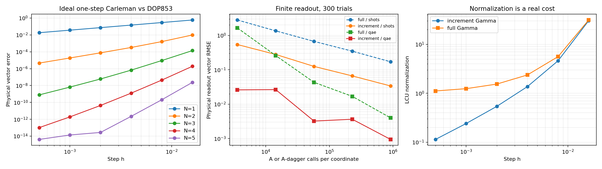
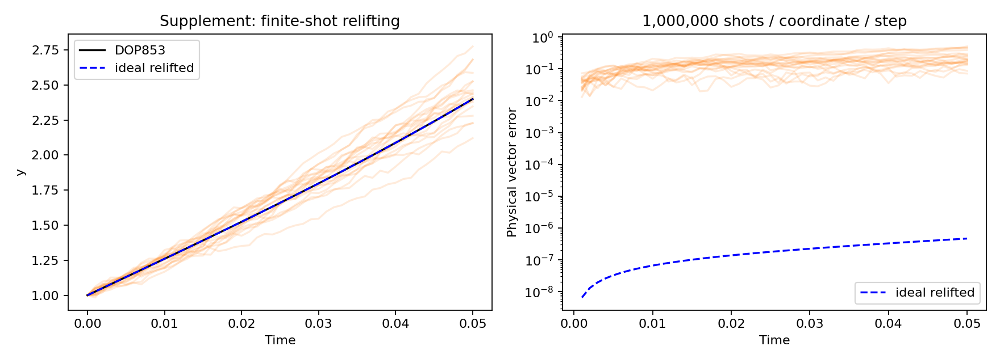

# Lorenz63：振幅编码的增量读出 relifted Carleman

本项目验证一条单步 workflow：**经典输入坐标 → 振幅编码单项式提升 → LCU 实现 Carleman 增量传播 → 只估计三个干涉量 → 恢复下一步坐标**。

目标是贴近同初值的高精度经典数值轨道。这里不把目标改成概率分布，不做完整 Carleman 态层析，也不依赖关于混沌长期预测的假设。

实现包含真实的有限维酉线路状态向量演算、有限 shots、标准 QAE 的精确概率分布模拟，以及经典轨道对照。**这是一套小规模算法验证，不是可扩展量子门编译器，也没有证明量子优势。**

## 1. 快速运行

Python 3.10+：

```bash
python -m pip install -r requirements.txt
python -m unittest -v test_validation.py
OPENBLAS_NUM_THREADS=1 python experiment.py --out results
```

Windows 可省略 `OPENBLAS_NUM_THREADS=1` 前缀。依赖仅为 NumPy、SciPy、Matplotlib，不需要量子硬件或 Qiskit。

默认实验随机种子为 `20261022`，每个读出设置进行 300 次独立重复：

```bash
python experiment.py --out results --seed 20261022 --trials 300
```

关于三种归一化、不同 S 的比较、增量法适用条件、误差界和含全部重复次数的成本，见 [完整理论推导](THEORY.md)。尺度实验可单独运行：

```bash
OPENBLAS_NUM_THREADS=1 python scale_study.py --order 3 --h 0.001
```

文件：

| 文件 | 功能 |
|---|---|
| `carleman.py` | Lorenz 模型、单项式生成元、酉扩张、LCU 状态向量、Hadamard 读出、QAE |
| `experiment.py` | 单步精度、测量预算对照、补充多步实验、作图与数据导出 |
| `test_validation.py` | 链式法则、非厄米 block encoding、Taylor 误差界、带符号读出、QAE 检验 |
| `THEORY.md` | 归一化、尺度、截断与读出误差、单步／多步／多次运行的完整成本推导 |
| `scale_study.py` | 固定物理问题扫描 S，验证相似变换并比较查询成本前因子 |
| `results/scale_study.csv` | 尺度扫描原始数据，包含域范数界与保守截断界 |
| `results/scale_study.png` | B、alpha、Gamma 与物理读出因子的尺度对照 |
| `results/summary.json` | 默认实验的完整参数与关键结果 |
| `results/convergence.csv` | 阶数与步长扫描 |
| `results/readout.csv` | 查询预算相同的有限读出实验 |
| `results/classical_timing.csv` | 仅供参考的本机经典计算时间 |
| `results/trajectory.npz` | 参考轨道、理想 relifted 轨道、有限 shots 轨道 |
| `results/single_step.png` | 单步精度、读出 RMSE、归一化因子 |
| `results/trajectory.png` | 短时间多步验证 |

## 2. 模型、有界性与缩放

采用标准参数：

```math
\dot x=10(y-x),\quad
\dot y=28x-y-xz,\quad
\dot z=xy-\frac83z.
```

默认初值为 `(1,1,1)`。参考解由 SciPy `DOP853` 计算，`rtol=2.3e-14, atol=2e-14`；它是高精度浮点参考，不是区间算术严格认证的精确解。接近双精度底噪的误差不用于宣称高阶收敛率。

使用固定坐标变换：

```math
u=c+Sv,\qquad c=(0,0,38),\quad S=64.
```

Lorenz 的一个吸收球以 `c` 为中心、半径约 `43.88`；稍微扩大后仍小于 `64`，所以对该域内初值可取 `||v||<1`。域外初值需要另选尺度或先证明有限时间轨道界，不能自动沿用此保证。代码允许生成任意有限输入的提升态，但几何范数界只在满足条件时成立。

缩放后的动力学为：

```math
\dot\xi=-10\xi+10\eta,
```

```math
\dot\eta=-10\xi-\eta-64\xi\zeta,
```

```math
\dot\zeta=64\xi\eta-\frac83\zeta-\frac{(8/3)38}{64}.
```

缩放能控制输入提升范数，但会改变二次项和常数项系数。它不保证 block encoding 的归一化因子很小；尺度不是越大越好。

## 3. Carleman 矩阵与阶数约定

保留所有总次数不超过 `N` 的不同单项式：

```math
\phi_N(v)=(1,\xi,\eta,\zeta,\xi^2,\xi\eta,\ldots)^T.
```

代码从链式法则自动构造：

```math
\frac{d}{dt}v^a=\sum_j a_jv^{a-e_j}f_j(v),
\qquad \dot y=C_Ny.
```

超过总次数 `N` 的耦合直接截断。不同单项式数：

```math
D_N=\binom{N+3}{3}.
```

默认 `N=3` 时 `D_N=20`，补齐到 32 维数据寄存器。不要将冗余张量表示的 `3^N` 当作经典算法必须处理的独立维数。

**阶数修正：** 对此截断约定，一般可以匹配一阶状态时间展开直到 `h^(N-1)`，局部误差是 `O(h^N)`；在标准稳定性条件下，逐步重提升的全局误差通常是 `O(h^(N-1))`。此前讨论中的 `O(h^(N+1))` 不适用于这里的 `N` 定义。

最简单的检查：`N=1` 会直接删去原系统二次项，所以其单步误差一般已为 `O(h)`。若希望匹配到 `h^p`，通常至少需要保留至总次数 `p+1`。特殊初值的抵消可能提高观测到的阶数，不能据此改变一般结论。

精确矩阵传播的 relifted 一步定义为：

```math
v_+=P_1e^{hC_N}\phi_N(v).
```

## 4. 振幅编码输入：尺度必须保留

制备：

```math
|\phi\rangle=\frac{\phi_N(v)}B,\qquad B=\|\phi_N(v)\|_2.
```

对本代码使用的非冗余、未加权单项式：

```math
B^2\le\sum_{k=0}^N\|v\|^{2k}\le\frac1{1-r^2},\quad\|v\|\le r<1.
```

`B` 从已知的三个输入数计算。不能只准备 `v/||v||` 后忽略其范数。代码使用稠密 Householder 酉门精确制备有符号提升态；这一制备成本不被当成免费操作。

对于可扩展实现，需另行选择结构化张量制备或压缩对称态制备，并计入乘法、旋转综合与辅助位成本。

## 5. 只实现增量算子

不重新估计整个输出，改为：

```math
v_+=v+\Delta v,\qquad
\Delta v=P_1(e^{hC_N}-I)\phi_N(v).
```

采用 Taylor 近似：

```math
E_K=\sum_{\ell=0}^K\frac{h^\ell C_N^\ell}{\ell!},\qquad D_K=E_K-I.
```

令

```math
\alpha=\sqrt{\|C_N\|_1\|C_N\|_\infty}\ge\|C_N\|_2,
\qquad A=C_N/\alpha.
```

这里的范数由小规模经典矩阵显式计算；大规模算法需说明怎样获得系数界和 oracle。权重和为：

```math
w_\ell=\frac{(h\alpha)^\ell}{\ell!},\quad
\Gamma_\Delta=\sum_{\ell=1}^Kw_\ell,\quad
\Gamma_{\rm full}=1+\Gamma_\Delta.
```

`taylor_data` 自适应选择 `K`，使标量级数尾界不超过 `1e-13`。若下一项为 `w_(K+1)`，后续项比值不超过 `r_tail<1`，则尾和不超过 `w_(K+1)/(1-r_tail)`，它也控制算子 Taylor 误差。

## 6. PREP–SELECT–PREP† 线路

次数寄存器制备：

```math
\mathrm{PREP}|0\rangle
=\sum_{\ell=1}^K\sqrt{w_\ell/\Gamma_\Delta}|\ell\rangle.
```

对每个 `ell`，取 `A^ell` 的 Julia 酉扩张：

```math
U_\ell=
\begin{pmatrix}
A^\ell & \sqrt{I-A^\ell(A^\ell)^\dagger}\\
\sqrt{I-(A^\ell)^\dagger A^\ell} & -(A^\ell)^\dagger
\end{pmatrix}.
```

这样可以正确处理非厄米 `C_N`，没有将 `exp(h*C_N)` 冒充普通哈密顿量演化。

再定义：

```math
\mathrm{SELECT}=\sum_\ell|\ell\rangle\langle\ell|\otimes U_\ell,
```

```math
U_\Delta=(\mathrm{PREP}^\dagger\otimes I)
\mathrm{SELECT}(\mathrm{PREP}\otimes I).
```

辅助位全为零的 block 为 `D_K/Gamma_delta`。

```text
order: |0> ──PREP──────●──────PREP†────────────
                      │
block: |0> ─────────SELECT─────────────────────
                      │
data:  |0> ──U_lift────┴───────────────────────
```

代码有两个相互校验的实现：

1. `DenseLCUCircuit`：每个 `U_ell` 用稠密 SVD 构造，直接扩张 `A^ell`。这是较小的参考线路。
2. **默认 `ProductLCUCircuit`**：只扩张基础 `A=C_N/alpha` 得到 `U_C`；引入 `K` 个独立成功辅助位。在第 `ell` 个分支上，对前 `ell` 个新辅助位分别调用 `U_C`，其全零 block 正好为 `A^ell`。它不预先构造 `C_N^ell` 来实现 SELECT。

乘积版 SELECT 可写成以下受控块的乘积，按 `t=0,...,K-1` 依次作用：

```text
order: |ell> ──[ell>=1]──[ell>=2]── ... ──[ell>=K]──
                  │          │                │
flag0: |0> ────── U_C ────────────────────────────────
flag1: |0> ───────────────── U_C ──────────────────────
 ...                                           │
flagK: |0> ─────────────────────────────────── U_C ────
data:  |phi> ──────┴──────────┴───── ... ────────┴────
```

默认一次干涉制备需要 `K=9` 次受控基础 `U_C` 调用；逆线路反转顺序并调用 `U_C†`。代码实际执行 PREP、这些受控乘积和 PREP† 的状态向量，而非只代入目标概率。两种实现的三个测试概率差约为 `1.67e-16`。

基础 `U_C` 本身和提升态制备仍由稠密矩阵构造，尚未完成 Lorenz 稀疏生成规则到基本门的高效编译。次数比较控制、辅助位、门综合和纠错成本均不可忽略。本文不将这些稠密门视为免费 oracle，也不宣称已实现量子优势。

## 7. 三个 Hadamard test，保留坐标符号

令 `e_j` 是三个一阶单项式的索引，构造基态置换 `R_j|0>=|0_anc,e_j>`。令：

```math
V_j=R_j^\dagger U_\Delta(I\otimes U_{\rm lift}).
```

则：

```math
a_j=\langle0|V_j|0\rangle
=\frac{\Delta v_j}{B\Gamma_\Delta}.
```

```text
test: |0> ──H────●────H────measure Z
                │
work: |0> ─────V_j─────────
```

本系统与线路矩阵均为实数，故测试位测得 0 的概率：

```math
p_j=\frac{1+a_j}{2}.
```

恢复物理坐标：

```math
u_{+,j}=u_j+SB\Gamma_\Delta(2p_j-1).
```

**不做全态层析，不测高阶单项式，也不先后选择传播成功分支。** 三个干涉测试直接包含非酉传播的归一化代价。只测计算基的概率平方无法恢复符号，因此干涉参考是必要的。

默认乘积版 Hadamard 状态向量线路使用 **19 个量子比特**：4 个次数位、9 个成功辅助位、5 个数据位、1 个测试位。稠密幂参考版使用 11 位。稠密制备门没有额外算术辅助位；可扩展的算术／旋转编译需要重新计数。

## 8. 有限 shots 与 QAE

定义物理读出因子：

```math
F_\Delta=SB\Gamma_\Delta.
```

### 普通 shots

每个坐标采样 `n` 次测试位，令 `p_hat=n0/n`：

```math
\hat u_{+,j}=u_j+F_\Delta(2\hat p_j-1).
```

其方差为：

```math
\mathrm{Var}(\hat u_{+,j})
=\frac{F_\Delta^2(1-a_j^2)}n.
```

只有三个坐标消除了对全态维数的层析需求，但不能消除 `1/delta^2` 的采样精度依赖。

### 振幅估计

将整个 Hadamard test 的无测量部分记为 `A_j`，成功子空间定义为测试位等于 0。标准 QAE 对其 Grover 迭代作相位估计。

代码在 Grover 的精确二维不变子空间中执行受控幂与逆 QFT。这与理想 QAE 的测量分布一致，不是人为添加的高斯噪声；但没有展开包含所有工作寄存器的完整 QAE 电路，也未执行硬件门。

设相位位数 `q`，`M=2^q`，重复 `r=7` 次取中位数。每个坐标计入：

```math
Q=r[1+2(M-1)]
```

次 `A_j` 或 `A_j†` 调用：每轮初始制备一次，`M-1` 次 Grover 迭代每次包含两次制备／逆制备。普通 shots 使用相同 `Q` 次调用预算进行比较。

该计数不是基本门数：默认每次 `A_j/A_j†` 内含 9 次受控 `U_C/U_C†` 调用，还需加上提升态制备、次数比较控制、反射、QFT 和门综合。默认最大预算的三个坐标合计约 **24,772,419 次基础 block 调用**，不是 2,752,491 个基本门。不同方案每个 `A_j` 的精确门成本也可能不同。

QAE 的分辨率具有网格效应，故有限样本误差不会严格随每个 `q` 单调下降。代码导出 RMSE、误差中位数和 95% 分位数，不仅展示最好结果。

## 9. 单步复杂度

设一次完整干涉制备／逆制备成本为 `C_delta`，要求物理坐标加性误差不超过 `delta`，则：

```math
G_{\rm shots}=\widetilde O\left(C_\Delta\max\{1,F_\Delta^2/\delta^2\}\right),
```

```math
G_{\rm QAE}=\widetilde O\left(C_\Delta\max\{1,F_\Delta/\delta\}\right).
```

三个坐标只贡献常数因子。在 `h*alpha << 1`、`B=O(1)` 时，`Gamma_delta=O(h*alpha)`，增量读出相比完整坐标读出有利。

若只看测量归一化系数，QAE 查询因子之比为：

```math
\frac{\Gamma_{\rm full}}{\Gamma_\Delta}
=\frac{1+\Gamma_\Delta}{\Gamma_\Delta},
```

普通 shots 的方差系数之比约为它的平方；精确值还包含 `1-a_j^2`。这些是**两种量子读出方案之间**的改善，不是对经典数值积分的量子加速证明。

误差预算至少应拆为：

```math
\epsilon_{\rm total}\le
\epsilon_{\rm Carleman}+
\epsilon_{\rm Taylor}+
\epsilon_{\rm arithmetic/gates}+
\epsilon_{\rm readout}+
\epsilon_{\rm reference}.
```

当前实验使用双精度精确矩阵门，未加入硬件门噪声、纠错开销或有限门集合综合误差。

### 9.1 只读三个量与全部读出的比较：先统一符号

这里 `d=3` 是 Lorenz 状态维数，`N` 是 Carleman 总次数截断阶数，`K` 是传播的 Taylor 次数。它们不能互换。保留不同单项式的数量为：

```math
D_N=\sum_{k=0}^N\binom{k+2}{2}=\binom{N+3}{3}=\Theta(N^3).
```

恰好总次数为 N 的一层只有 `binom(N+2,2)=Theta(N^2)` 项，但本算法使用从 0 到 N 的所有层，不能把单层项数当成完整提升维数。因此本项目中 `D_N^2=Theta(N^6)`，不是 `Theta(N^4)`。

一般 d 维时累计项数是 `binom(N+d,d)`。固定 d、增加 N 与固定 N、增加 d 是两种不同的渐近问题；当前所有关于 N 的阶数均指固定 `d=3`。

| 截断阶数 N | 累计项数 D_N | D_N/3 |
|---:|---:|---:|
| 2 | 10 | 3.33 |
| 3 | 20 | 6.67 |
| 4 | 35 | 11.67 |
| 5 | 56 | 18.67 |
| 10 | 286 | 95.33 |
| 20 | 1771 | 590.33 |

零阶常数分量已知，实际读出全部未知分量时可将 `D_N` 换成 `D_N-1`；不改变渐近阶数。默认 N=3 时，这一目标数之比为 `19/3=6.33`。

### 9.2 相同逐分量精度：测量目标数从 D_N 降到 3

为公平比较，先统一比较**缩放后、同一单项式基下的增量向量**：

```math
z=D_K\phi_N(v),\qquad F_0=B\Gamma_\Delta.
```

读取第 j 个增量时，Hadamard test 满足 `a_j=z_j/F_0`，估计得到 `z_hat_j=F_0*a_hat_j`。这里 `F_0` 不含物理坐标尺度 S。三个一阶坐标转换回物理单位时，再用 `F=S*F_0` 或将容差替换为 `delta_phys/S`。高阶单项式不能都套用同一个物理坐标单位来比较精度。

设读取 q 个实分量，**每个分量**绝对误差至多 delta，总失败概率至多 eta_fail；每个完整干涉制备／逆制备成本为 `C_delta`。对现有逐分量线路，在非平凡精度区间 `delta << F_0`：

```math
G_{\rm shots}(q,\delta,\eta_{\rm fail})
=O\!\left(q C_\Delta\frac{F_0^2}{\delta^2}
\log\frac{q}{\eta_{\rm fail}}\right),
```

```math
G_{\rm QAE}(q,\delta,\eta_{\rm fail})
=\widetilde O\!\left(q C_\Delta\frac{F_0}{\delta}
\log\frac{q}{\eta_{\rm fail}}\right).
```

其中 QAE 的对数因子来自置信度提升；具体实现还含控制、反射和 QFT 开销。大容差时应保留每目标至少一次调用的下限。三种设置不等于三次 shots。

忽略上述对数因子，比较如下：

| 同一逐分量误差 delta | 只读三个一阶分量 | 逐分量读出所有分量 |
|---|---|---|
| 测量设置数 | 3 | D_N（可跳过常数项） |
| 普通 shots 总门数 | O(C_delta F_0^2/delta^2) | O(D_N C_delta F_0^2/delta^2) |
| QAE 总门数 | O~(C_delta F_0/delta) | O~(D_N C_delta F_0/delta) |
| 只比较输出数带来的节省 | — | 约 D_N/3 倍 |

这是**相同逐分量精度下、同一种坐标读出算法**的比较，并非任意全态读出方法的最优下界。不同振幅的方差、已知零分量、结构性重建等还可能进一步改变实际成本。

### 9.3 相同向量二范数误差：额外维数因子来自精度分配

若要求输出 q 维向量满足 `||z_hat-z||_2 <= epsilon`，一个直接、保守的选择是每个分量误差：

```math
\delta=\frac{\epsilon}{\sqrt q}.
```

代入上述逐分量读出算法，得到以下充分成本估计：

```math
G_{\rm shots}^{\rm coord}(q,\epsilon)
=\widetilde O\!\left(C_\Delta\frac{q^2F_0^2}{\epsilon^2}\right),
```

```math
G_{\rm QAE}^{\rm coord}(q,\epsilon)
=\widetilde O\!\left(C_\Delta\frac{q^{3/2}F_0}{\epsilon}\right).
```

| 固定输出向量的二范数容差 epsilon | 只读三个分量 | 逐分量读完整 D_N 维向量 |
|---|---|---|
| 普通 shots | O~(C_delta F_0^2/epsilon^2) | O~(D_N^2 C_delta F_0^2/epsilon^2) |
| QAE | O~(C_delta F_0/epsilon) | O~(D_N^(3/2) C_delta F_0/epsilon) |

这里确实出现了 `D_N^2`，但它由**D_N 个输出 × 每个输出需要 epsilon/sqrt(D_N) 的精度**产生，不是因为纯态天然有 D_N^2 个未知振幅。对于固定每分量精度的比较，不能额外再乘这个精度分配因子。

这些公式只描述当前逐坐标方案，不是全态层析的最优复杂度；使用不同测量模型、利用纯态结构或批量估计可能改善对维数的依赖。

### 9.4 振幅向量与完整密度矩阵不是同一个输出

一个 D 维纯态由 D 个复振幅描述，扣除归一化和全局相位后有 `2D-2` 个实自由度；本项目的有符号实振幅态更少。因此读出纯态的全部振幅，不需要恢复一个任意混态的 D^2 个自由度。

完整密度矩阵 `rho` 有 D^2 个矩阵元素，但纯态满足 `rho=|psi><psi|`，是秩一矩阵，元素之间存在强约束。混态层析中常见的 D^2 复杂度不能直接用作本算法的全振幅读出基线。

例如，在允许适当联合测量的“未知态副本”模型中，秩 r、D 维状态达到迹距离 epsilon 的层析可使用约 `O~(D*r/epsilon^2)` 份副本；纯态 r=1 与一般满秩 r=D 的维数依赖不同，参见 [Haah et al., Sample-optimal tomography of quantum states](https://arxiv.org/abs/1508.01797)。这不是本项目线路的成本公式：它估计归一化状态，在全局相位意义下重建，还需要另行处理非酉输出的制备、尺度和参考相位。

### 9.5 其他参数哪些改变、哪些保留？

| 参数／成本 | 从全读出改成只读三个量的影响 |
|---|---|
| 输出数 q | 从 D_N（或 D_N-1）降到 3，是直接改善来源 |
| 每分量容差 delta | 同等逐分量容差时，shots 的 delta^-2 与 QAE 的 delta^-1 不变 |
| 向量容差 epsilon | 只需给三个分量分配误差，避免完整向量所需的 sqrt(D_N) 精度收紧 |
| 失败概率 eta_fail | 联合成功所需的 log(q/eta_fail) 改为常数目标数对应的对数项 |
| 输入提升范数 B | 仍然存在，不因只读三个量而消失 |
| 传播归一化 Gamma_delta | 同一个传播线路下不变；只选三个目标本身不会减小它 |
| h、alpha、K | 仍进入 Gamma_delta 与 C_delta；例如 Gamma_delta <= exp(h*alpha)-1 |
| 基础 block 调用 | 当前一次干涉制备仍需 K 次受控 U_C 调用，不能只算最后测试位测量 |
| 量子工作寄存器 | 仍需承载完整传播，不能直接从 D_N 维改成只传播三维 |
| 成功概率 | 当前直接干涉读出不额外后选择；改成投影方案必须另外计入成功概率 |
| 时间 T／多步数 m | 单步减少目标数，不自动消除多步误差传播和总失败概率分配 |

对于固定 d=3、固定缩放后系数，当前单项式矩阵的每行／列非零移位种类有常数上界，元素大小可随 N 线性增长，因此 `alpha=O(N*Lambda)` 可作为一类系数上界，Lambda 表示常数、线性和二次项的系数尺度。即使去掉显式输出数 D_N，N 仍可能经由 alpha、K 和制备成本进入总复杂度。

所以不能无条件写成“全读出 N^4，三个量 N^2”。假设未来另行证明 `C_delta=O~(N^2)`，且 F_0 有统一常数界，在固定每分量精度下，本项目累计 `D_N=Theta(N^3)` 会给出：只读三个量约为 `O~(N^2)`，全读出约为 `O~(N^5)`，另保留容差因子。若假设的是 `C_delta=O(D_N)`，才会得到“全读出 D_N^2、三个量 D_N”；这也是额外的成本模型假设。

当前基础门是稠密参考门，尚未证明 `C_delta=O(N^2)`。逐坐标读出减少了输出成本，但不等于整个振幅编码算法已经获得相对经典方法的量子优势。

## 10. 已运行结果

默认参数：`N=3, h=0.001, u0=(1,1,1)`。

| 项目 | 结果 |
|---|---:|
| 非冗余 Carleman 维数 | 20 |
| Taylor 次数 K | 9 |
| alpha | 215.5226206 |
| h*alpha | 0.2155226 |
| B | 1.2181871 |
| Gamma_delta | 0.2405100 |
| Gamma_full | 1.2405100 |
| 增量物理读出因子 F_delta | 18.7511 |
| 完整坐标物理读出因子 F_full | 96.7151 |
| 读出归一化查询因子改善 | 5.1578 倍 |
| 对应方差系数比 | 26.6032 |
| 理想线路恢复值与 expm Carleman 的向量误差 | 3.17e-14 |
| 理想 Carleman 与 DOP853 的单步向量误差 | 6.54e-9 |
| 乘积版与稠密幂版测试概率最大差 | 1.67e-16 |

理想线路输出：

```text
[1.0001295302187256, 1.0259890050885050, 0.9983485801961010]
```

高精度 ODE 参考：

```text
[1.0001295302032480, 1.0259889988935935, 0.9983485823009421]
```

有限读出结果：相位位数 `q=16`，取 7 次 QAE 中位数，每个坐标预算为 **917,497 次 A/A† 调用**；三个坐标合计 **2,752,491 次**。

| 单步读出方法 | 300 次试验的物理向量 RMSE |
|---|---:|
| 完整坐标＋普通 shots | 1.706e-1 |
| 增量＋普通 shots | 3.382e-2 |
| 完整坐标＋QAE | 4.000e-3 |
| 增量＋QAE | 9.462e-4 |

最后一行的误差相对于对应的理想 Taylor-Carleman 输出，不是单独扣除了测量误差后的 ODE 总误差；默认单步的确定性误差远小于读出 RMSE。

采用 Hoeffding 界，若希望三个坐标分别达到 `1e-3` 误差、总失败概率不超过 0.05，默认增量方案的保守普通 shots 预算约为 **每坐标 3.37e9 次**。这是充分保证，不是必须达到的下界。



补充多步试验：`T=0.05, h=0.001`，20 条独立有限 shots 轨道，每步每坐标 1,000,000 shots。理想 relifted 最终向量误差约 `4.67e-7`，有限 shots 最终向量误差中位数约 `0.196`。该结果用于展示测量精度的影响，不是长期混沌误差研究。每条路径对应 1.5e8 次理想线路采样；代码利用精确二项分布批量采样，没有实际执行这么多条状态向量线路。



## 11. 怎么判断量子优势

本实验支持：

1. 只估计三个坐标是可行的，无需重建全态。
2. 在线路层面去掉单位项，比估计完整坐标后再减去输入更节省读出精度。
3. 标准 QAE 在相同理想制备调用预算下可以明显改善读出误差。

本实验没有支持“已经优于经典 Lorenz 数值积分”：

- 基础 U_C 的稠密酉块与提升态制备都要经典构造，不能将其当作免费 oracle；乘积版已计入生成各阶项所需的额外成功辅助位。
- 当前模拟器运行时间是经典模拟成本，不是量子硬件时间。
- 经典方法也只需计算三个输出，且可利用 `D_N=O(N^3)` 的对称压缩。
- 固定 `N,h` 后，一步映射就是三个多项式，经典可预计算三个目标行。
- 经典比较还应包括同精度 RK／Taylor 等直接积分器，不只比较大矩阵全量传播。

`classical_timing.csv` 只记录本机三个目标行与全矩阵求值的参考时间，排除传播矩阵预计算；不与 oracle 调用次数直接换算为加速比。

进一步证明单步优势，需要构造可扩展的制备与 SELECT 编译，并比较：

```math
C_\Delta\max\{1,SB\Gamma_\Delta/\delta\}
\quad\text{与}\quad
C_{\rm classical}^{(3)}(N,h,\delta).
```

## 12. 后续改进

优先级如下：

1. 利用 Lorenz Carleman 的生成规则编译稀疏 block encoding，减少稠密参考门的成本，并明确 alpha。
2. 使用更紧的系数分解与归一化，减小 Gamma_delta；不能仅用 ||D|| 的数值值替换 LCU 归一化而不提供实现。
3. 联合优化坐标平移、尺度、N、h，使确定性误差满足目标，同时降低 B、alpha、K。
4. 研究已知低阶预测项之后的高阶余项读出。若预测项本来就足够准确，经典算法可直接停止；需公平计入预测器成本。
5. 单步优势成立后，再分析每步精度分配、重提升次数及全流程稳定性。

## 13. 参考

- [Brassard et al., Quantum Amplitude Amplification and Estimation](https://arxiv.org/abs/quant-ph/0005055)
- [Childs and Wiebe, Hamiltonian Simulation Using Linear Combinations of Unitary Operations](https://arxiv.org/abs/1202.5822)
- [Gilyén et al., Quantum singular value transformation and beyond](https://arxiv.org/abs/1806.01838)
- [Liu et al., Efficient quantum algorithm for dissipative nonlinear differential equations](https://doi.org/10.1073/pnas.2026805118)

本文单步增量线路、代码约定和实验结论由上述原语组合推导；这些引用不代表原文已证明本 Lorenz workflow 的量子优势。
