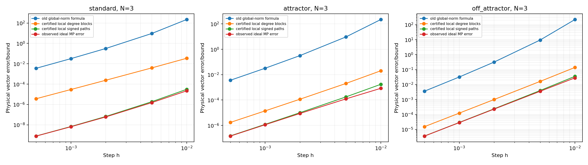

# 更紧的单步截断误差界：分块、真实耦合路径与局部包络

本轮从已有变分常数公式出发，给出**不依赖参考轨道的严格截断上界**，并把数值估计和实测值单独列出。默认案例的新上界约为 **6.86162e-9**，旧整体范数公式的数值值约为 **0.0320783**。

这不是通过把实验误差代入常数得到的拟合。新上界的计算只使用初值、Lorenz 参数、生成规则、有理区间包含和带严格余项的矩阵级数。

## 1. 先明确保证的对象

被界定的是理想单步 Carleman 截断误差：

```math
E(h)=u(h)-\left[c+S P_1 e^{hC_N}\phi_N(v_0)\right],
\qquad v_0=(u_0-c)/S.
```

这里 C_N 是从物理方程**代数上精确构造**的有理生成元。参数视作当前程序存储的 binary64 数的精确有理值，特别是 beta 使用该浮点数的精确值，而不是偷偷改成有理数 8/3。中心 c=(0,0,38)，未加权不同单项式总次数不超过 N。

严格上界**不包含**浮点生成元系数舍入、SciPy 矩阵指数误差、Taylor 求解器误差、门综合误差或量子读出误差。这些仍需另加误差预算。数学上的精确 8/3 参数系统若要单独认证，需要相应修改精确参数定义并重新生成证书。

适用范围目前由代码明确限制为标准 Lorenz 参数、S>0、h>0、N>=1，初值在以 c 为中心半径至少 44 的已知不变球内，且局部包含验证和级数余项条件成功。超出条件时程序报错，不返回伪认证值。公式可推广，但本实现没有自动认证其他参数区域。

不变球也可直接核验：令 w=u-c，在球面上有

```math
\frac12\frac{d}{dt}\|w\|_2^2
=-\sigma x^2-y^2-\beta w_z^2-\beta(\rho+\sigma)w_z
\le -R^2+\frac{\beta^2(\rho+\sigma)^2}{4(\beta-1)}<0.
```

此处用了 sigma>=1、beta>1。代码以精确有理数检查最后的不等式，因此存储 beta 与精确 8/3 的微小差别不会破坏该保证。

## 2. 保留残差的矩阵结构

令 G 是 N+1 次齐次单项式到保留层的遗漏耦合，它只有次数 N 的行非零。精确单项式向量满足：

```math
\dot\phi_N=C_N\phi_N+G\psi_{N+1}(v),
```

因此：

```math
E(h)=S\int_0^h P_1e^{(h-s)C_N}G\psi_{N+1}(v(s))\,ds.
```

旧界将传播、遗漏耦合和状态分别替换为整体范数，失去了哪些残差分量能沿哪些路径到达一阶坐标的信息。

## 3. 第一层收紧：按次数分块传播

令 C_ij 是次数块，定义：

```math
A_{ij}=\|C_{ij}\|_\infty\quad(i\ne j),\qquad
A_{ii}=\max\{0,\mu_\infty(C_{ii})\},
```

其中 `mu_infinity(B)=max_r(B_rr+sum_(s!=r)|B_rs|)` 是对数范数。这里把负对角比较率提高到零，使 A 全部非负，方便用正项级数严格包络；这只会放宽界。

常数层误差为零，故只需 i,j=1,...,N。若遗漏层强迫的无穷范数至多 r_N，则由分块 Dini 导数比较：

```math
\|E(h)\|_2\le\sqrt3 S r_N
\int_0^h (e^{A\tau})_{1N}\,d\tau.
```

这是可证明的分块上界，避免所有层使用同一个整体增长率。不过，仅给遗漏层一个最大范数仍可能很松，因为最强的遗漏分量未必能有效传播到目标坐标。

## 4. 第二层收紧：先合并实际路径，再取绝对值

定义：

```math
H_k=P_1C_N^kG.
```

H_k 的一个元素等于所有长度为 k 的传播路径与遗漏耦合的**带符号总和**。代码先用 Fraction 精确相加，最后才取绝对值，避免把每条路径的正负相消丢掉。

二次向量场每次最多跨一个次数层，因此 H_k=0 对所有 k<N-1 成立。若对整个时间段已知：

```math
|\psi_{N+1,a}(v(s))|\le m_a,\quad 0\le s\le h,
```

则截到 J 阶传播的分量界为：

```math
b_j^{(J)}=
\sum_{k=0}^J\frac{h^{k+1}}{(k+1)!}
\sum_a |(H_k)_{ja}|m_a.
```

注意这里计算的是 `|C^k G|`，不是先换成 `|C|^k |G|`。后者仍会丢失重要相消；只在最后很小的级数尾中使用它。

### 默认案例为何特别紧

N=3 时，前两个 H 均为零；第一个非零项满足：

```math
H_2\psi_4(v)=S^3(0,\xi^3\zeta,-\xi^3\eta)^T.
```

其中 x 分量仍为零，需要额外耦合才会产生误差。大量包含较大 z 偏移的残差并不能沿最短路径直接到达一阶坐标。

默认初值中 xi=eta=1/64，zeta=-37/64。旧半径界没有利用这些很小的 x/y 因子；实际主路径包含 xi^3，而不是任意方向都达到全局半径的四次幂。只看领先项也不够，尤其 z 分量的高阶贡献可能重要，所以程序保留全部 k<=J 的路径。

## 5. 局部轨道包络怎样得到，为什么不依赖 DOP853

使用物理坐标上的有理区间盒 X。首先寻找严格包含：

```math
u_0+[0,h]f(X)\subset\operatorname{int}(X).
```

若真实解首次离开 X，则积分方程会把首次离开的点放回盒内，产生矛盾。结合多项式向量场的局部 Lipschitz 性和有界延拓，得到整个 [0,h] 上的包络。

然后反复取 Picard 积分像与当前盒的交集：

```math
X_{r+1}=X_r\cap\left(u_0+[0,h]f(X_r)\right).
```

已包含真实解的盒的积分像仍包含真实解，所以每次收紧都保留保证。代码先作精确 Fraction 运算，再将端点向外取到 80 位二进制网格，避免分母无限膨胀，不采用浮点的“看起来够宽”判断。

由归一化后的局部盒得到每个坐标的最大绝对值 M_i，再取：

```math
m_a=\prod_i M_i^{a_i}.
```

还可与已知不变球给出的逐坐标界取较小者。严格自包含的初始盒、积分像、最终包络和外向舍入信息均写入证书。

## 6. 传播级数的尾怎样严格控制

令 M=|C_N|、g=|G|m、a=||M||_infinity，并计算正行向量：

```math
r_j=e_j^T P_1 M^{J+1}.
```

对遗漏项使用非负比较，若 h*a/(J+3)<1，尾界为：

```math
t_j\le
\|g\|_\infty(r_j\mathbf1)
\frac{h^{J+2}}{(J+2)!}
\frac1{1-ha/(J+3)}.
```

最终：

```math
\|E(h)\|_2\le S\sqrt{\sum_{j=1}^3(b_j^{(J)}+t_j)^2}.
```

所有有限和与几何尾均用有理数计算，平方根用整数平方根向上取到 100 位二进制网格，显示的小数再次向上舍入。整体范数只出现在极小的高阶尾里；默认案例该尾的物理向量上界约 1.57e-27。

相同表达式的非负系数随步长增大，因此用 h 得到的界也控制同一初值、同一连续 Carleman 段内更早的时刻；它不直接认证多次重提升后的整条轨道。

## 7. 默认结果与证据分类

默认 N=3,h=.001,S=64,u0=(1,1,1)：

| 量 | 数值 | 分类 |
|---|---:|---|
| 原整体范数公式 | 3.20783e-2 | 已有上界公式的普通浮点求值，未作外向认证 |
| 分块比较＋全局半径 | 6.58046e-3 | 严格有理上界 |
| 分块比较＋局部包络 | 2.97008e-5 | 严格有理上界 |
| 合并路径＋全局半径 | 9.09146e-4 | 严格有理上界 |
| 合并路径＋局部包络 | **6.86162025731e-9** | **严格有理上界，展示值向上舍入** |
| 沿数值参考轨道积分的三角界估计 | 6.5427356e-9 | 数值估计，无严格求积余项包络 |
| 高精度理想截断误差 | 6.54273061213e-9 | 数值实测，不是证明依据 |
| DOP853／SciPy 浮点实现的差 | 6.5427271e-9 | 含实现与参考数值误差的实测 |

新严格界是理想截断实测值的约 1.04874 倍，已能解释此前的理论／实验差距。证明的依据是第 2–6 节，不是表中“恰好没有越界”。

数值轨道积分另计算：

```math
S\int_0^h\left|P_1e^{(h-s)C_N}G\psi_{N+1}(v_{\rm ref}(s))\right|ds.
```

参考轨道和 16／32 点高斯求积都仅为数值计算。两次求积之差是诊断指标，不能当作误差认证；即使这个估计更小，也不替换严格界。保留符号的 VOC 积分重构与独立高精度误差向量也作了比较，用于检查公式、参数和索引的一致性。

## 8. 不同 N、h 与初值

实验覆盖 75 组：N=1,...,5；h=.0005,.001,.002,.005,.01；初值 `(1,1,1)`、`(-8,8,27)`、`(20,20,30)`。所有高精度理想截断观测均小于新严格界；界／实测值之比约在 **1.0006–5.47**，不是任意初值下的通用紧度定理。

| 初值 | N | h | 高精度理想误差 | 新严格界 |
|---|---:|---:|---:|---:|
| standard | 3 | .0005 | 7.8336e-10 | 8.0067e-10 |
| standard | 3 | .001 | 6.5427e-9 | 6.8617e-9 |
| standard | 3 | .01 | 2.1976e-5 | 3.0826e-5 |
| attractor | 3 | .001 | 1.1241e-6 | 1.2079e-6 |
| attractor | 5 | .01 | 2.0059e-7 | 1.0976e-6 |
| off_attractor | 3 | .001 | 2.8689e-5 | 2.9351e-5 |

表中简写的上界均向上展示；完整有理值和外向十进制值见证书。



有两组情况的双精度实现观测超过理想截断界：standard,N=5,h=.0005 和 .001。其理想截断误差分别约 1.18e-17 和 5.36e-16，浮点实现／参考差却约 4.11e-15 和 1.38e-14。这不是新界失败，而是它没有包含系数和矩阵指数等舍入误差。若要认证完整浮点或量子算法，必须将这些误差项加回。

## 9. 代码、重放和适用条件

```bash
OPENBLAS_NUM_THREADS=1 python -m unittest -v test_residual_bounds.py
OPENBLAS_NUM_THREADS=1 python residual_bound_study.py
python verify_residual_certificates.py
```

只检查默认案例：

```bash
python residual_bound_study.py --quick --out smoke_residual
```

| 文件 | 内容 |
|---|---|
| `residual_bounds.py` | 精确生成元、验证包络、分块比较、带符号路径、严格级数尾 |
| `residual_bound_study.py` | 新旧界、数值 VOC 积分和独立误差观测的比较 |
| `verify_residual_certificates.py` | 不运行参考轨道或求积，重放全部有理证书 |
| `results/residual_bounds/comparison.csv` | 全部 75 组比较，分类列名明确 |
| `results/residual_bounds/certificates.json` | 参数、包络、严格自包含证明数据、精确上界与外向小数 |
| `results/residual_bounds/numerical_observations.json` | 数值误差向量、参考细化和积分重构诊断 |

限制：

- 包络验证失败时应细分时间段或换验证方法，不能直接用采样轨道的最大值冒充严格包络。
- 相消必须在精确／外向可靠的计算中保留。用浮点相消后的很小矩阵元素直接当作保证值可能不安全。
- 对更大 h 或强相消问题，有限阶逐项绝对值可能再次变松；严格性仍在，但紧度需重测。
- 二次系统的遗漏只注入顶层。更高次非线性需增加遗漏层并修改耦合带宽，不能原样套用本代码。
- 单步初值／提升假设精确一致。数值初值不确定或多步读出误差须通过初值区间和稳定性分析另行传播。
- 收紧截断界不等于降低量子测量成本，也不等于已经证明量子优势。
