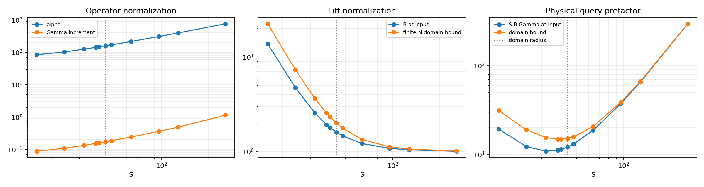

# 归一化、尺度 S、增量读出与端到端成本

本文是现有 workflow 的推导说明。假设经典初值已知，输出为同初值轨道的三个经典坐标。它不是概率分布算法，也不把经典参考轨道自动当成严格精确解。查询复杂度与基本门数分开计量。

当前任务范围已收敛为：先评估 T=5 的精确轨道数值近似，更长时间只考虑统计量。见 [短时间成本比较](SHORT_TIME_COMPARISON.md)。理想无噪声硬件仍需支付以下振幅读出成本；它不等于拥有免费、精确的经典实数振幅读出。

符号：状态维数 `d=3`；Carleman 截断阶数 N；提升维数 `D_N=binom(N+3,3)`；Taylor 次数 K；步长 h；步数 `m=T/h`；独立完整运行次数 R；QAE 的中位数重复次数 `r_AE`；总失败概率 eta。R、m、r_AE 是三种不同的重复。

## 1. 为什么有三种归一化

### 1.1 坐标缩放是可选预条件，不是量子公设

令 `u=c+Sv`，S>0。对二次系统，固定中心 c 后可写成：

```math
\dot v=\frac{g_0}{S}+J_f(c)v+S Q(v).
```

所以增大 S 会减小坐标与常数项，但增大二次项系数。Lorenz 中 `c=(0,0,38)`，S=64 是初始选择，并非已证明的最优尺度。

### 1.2 振幅态必须有单位范数

```math
|\phi\rangle=\frac{\phi_N(v)}{B},\qquad B=\|\phi_N(v)\|_2.
```

这是 Born 概率总和为一的要求。输入的三个经典坐标已知，故 B 可计算并保留；不能把范数丢掉。量子态归一化不表示原始解具有单位范数，也不表示已实现某个未知向量的免费非线性归一化。

若物理坐标满足 `||u-c||<=R_dom`，设 `r=R_dom/S`，则未加权不同单项式满足：

```math
B^2\le \sum_{k=0}^N r^{2k}.
```

这是有限 N 下的有效界，r>=1 时仍成立。r<1 的额外好处是它还能被 `1/(1-r^2)` 控制，界不随 N 增长。r=1 时上界为 N+1；r>1 时随 N 可能指数增长。r<1 不是任意有限阶算法合法的必要条件。

### 1.3 Block encoding 必须嵌入一个压缩算子

酉算子的任意子块范数不超过 1。因此要把 C_N 作为酉门的子块，需要：

```math
\langle0|U_C|0\rangle=C_N/\alpha,\qquad \alpha\ge\|C_N\|_2.
```

代码选择 `alpha=sqrt(||C_N||_1 ||C_N||_inf)`。这是足以使稠密 Julia 酉扩张存在的界；实际稀疏编译器可能给出更大的归一化因子，需要使用真实实现的值。

LCU 传播还有另一个归一化：

```math
\Gamma_\Delta=\sum_{\ell=1}^K\frac{(h\alpha)^\ell}{\ell!},\qquad
\Gamma_{\rm full}=1+\Gamma_\Delta.
```

它来自 LCU 系数的绝对值和，使成功 block 等于 `(E_K-I)/Gamma_delta`。它通常不是最小可能的 `||E_K-I||`；不能在没有新线路的情况下直接替换成更小的算子范数。

三个因素共同决定物理读出成本：

```math
F(S)=S B(S)\Gamma_\Delta(S),\qquad
\Delta u_j=F(S)a_j,\quad |a_j|\le1.
```

B、alpha、Gamma_delta 的含义不同。只减少 B，不足以判断总成本下降。

## 2. 不同 S 的实测比较

复现：

```bash
OPENBLAS_NUM_THREADS=1 python scale_study.py --order 3 --h 0.001
```

结果在 `results/scale_study.csv` 和 `results/scale_study.png`。固定中心、初值 `(1,1,1)`、N=3、h=0.001、同一 alpha 规则和 Taylor 尾容差，得到：

| S | 输入提升范数 B | alpha | Gamma_delta | 物理读出因子 F | K | 基础查询前因子 K*F |
|---:|---:|---:|---:|---:|---:|---:|
| 16 | 13.7167 | 84.0238 | 0.087655 | 19.2373 | 7 | 134.66 |
| 32 | 2.5538 | 124.9933 | 0.133141 | 10.8804 | 8 | 87.04 |
| 44 | 1.6009 | 158.9444 | 0.172273 | 12.1352 | 9 | 109.22 |
| 48 | 1.4693 | 170.2606 | 0.185614 | 13.0903 | 9 | 117.81 |
| 64 | 1.2182 | 215.5226 | 0.240510 | 18.7511 | 9 | 168.76 |
| 128 | 1.0446 | 396.5543 | 0.486693 | 65.0771 | 11 | 715.85 |
| 256 | 1.0106 | 758.6000 | 1.135285 | 293.7213 | 14 | 4112.10 |

固定物理坐标误差 delta，QAE 制备查询前因子约正比于 F，基础 block 查询还多乘 K；普通 shots 前因子约正比于 F^2。其他制备和控制开销可能也依赖 S 和精度位数，不能只用 K*F 宣称实际加速。

此表说明：B 随 S 增大趋近 1，但 F 反而可能急剧增大。S=32 在这组有限 N、特定输入的离散扫描中比 S=64 更省查询；它的输入归一化半径超过 1，失去了随 N 一致的几何范数界。S>44 可让整个半径 44 的已知不变球满足 r<1。表格不证明某个 S 对所有初值、N、h 或完整运行最优。

对固定中心和完整总次数截断，改变 S 还有精确的相似变换关系。设参考尺度 S0，并令：

```math
H_{aa}=(S_0/S)^{|a|},\qquad
\phi_{N,S}=H\phi_{N,S_0},\qquad
C_{N,S}=HC_{N,S_0}H^{-1}.
```

因此精确 Carleman 传播恢复到物理坐标后不随 S 改变；固定 K 的 Taylor 多项式也有此性质。自适应 K、舍入与读出误差可以随 S 改变。本扫描的物理 Carleman 解跨尺度差异约为浮点舍入量级。



## 3. 增量优势适用于哪些系统

本技巧不依赖 Lorenz、二次非线性或混沌。只要一步问题可表示为线性升维传播，且输入状态的目标坐标已知，就可以尝试估计更新而不是整个输出。

若以相同的 Taylor-LCU 构造比较完整 E_K 和增量 D_K=E_K-I，令 a=h*alpha，则：

```math
\Gamma_\Delta\simeq e^a-1,\qquad
\frac{\Gamma_{\rm full}}{\Gamma_\Delta}
\simeq\frac{e^a}{e^a-1}.
```

当 a<<1，增量归一化为 O(a)，而完整传播为 1+O(a)：同样绝对精度下，QAE 查询前因子可能改善约 1/a，普通 shots 方差系数约改善 1/a^2。这是两种具体读出实现之间的比较，不是对所有完整传播算法的普适优势定理。

有利的类型包括：

- 非刚性、步长足够短的线性 ODE，增量法同样适用。
- 在局部展开区域内，Carleman 生成元的有效归一化可控的多项式系统。
- 已知恒等／简单主传播、只有较小修正的扰动系统。更一般的主项剥离还需提供修正算子线路。

优势可能很小或消失的情况：

- 刚性、强耦合、高频系统导致 h*alpha>=1；不能只看实际轨道的变化量判断 LCU 归一化。
- 实际一步接近恒等，但所用 LCU 分解非常松。相消不会自动让系数绝对值和变小。
- 完整传播已有更好的酉实现，归一化接近 1；不能把它与低效 Taylor-LCU 的 Gamma_full 混为一谈。
- 输入坐标未知、也不能低成本计算它们；把输出写为“已知输入＋更新”便不再免费。
- 要求固定相对更新误差：若 delta=epsilon_rel*||Delta u|| 且更新本身 O(h)，h 因子可能被精度要求抵消。
- 更新已小于允许的绝对误差，且有可靠上界：直接保留旧值即可，无须量子估计。

## 4. 单步确定性误差的推导

### 4.1 假设和范数

以下使用欧氏范数和其诱导算子范数。设每个数值输入和相应短时间真实轨道均留在一个有界区域，归一化轨道满足 `||v(t)||<=r`。这些域条件必须验证，不能由单个初值有界自动推到含随机读出的全部数值轨道。

Lorenz 可以选择以 `(0,0,38)` 为中心、半径 `R_dom=44` 的正向不变球。含读出误差的数值点可能离开它；若要使用这个球的统一界，需要额外验证域保持，或在每步加入投影到该凸球的操作。投影对球内真实点不增加距离，但当前默认实验尚未加入此步骤。

### 4.2 Carleman 截断残差

精确单项式向量的前 N 阶满足：

```math
\dot\phi_N=C_N\phi_N+P_N^*R_N(t),
```

P_N 提取恰好总次数 N 的层；二次向量场使遗漏残差仅注入这一层。设该层与 N+1 层的耦合矩阵为 C_(N,N+1)，取：

```math
\beta_N\ge\|C_{N,N+1}\|_2,\qquad
\|R_N(t)\|_2\le\beta_N r^{N+1}.
```

从完全一致的提升初值出发，变分常数公式给出一阶坐标截断误差：

```math
\phi_N(h)-e^{hC_N}\phi_N(0)
=\int_0^h e^{(h-s)C_N}P_N^*R_N(s)\,ds.
```

从次数 N 层传到次数 1 层至少要经过 N-1 次相邻层耦合，因此：

```math
P_1C_N^\ell P_N^*=0\quad(\ell<N-1).
```

用 alpha>=||C_N|| 得到：

```math
\|P_1e^{\tau C_N}P_N^*\|
\le \sum_{\ell=N-1}^{\infty}\frac{(\alpha\tau)^\ell}{\ell!}
\le e^{\alpha\tau}\frac{(\alpha\tau)^{N-1}}{(N-1)!}.
```

积分并恢复物理单位：

```math
d_N(h):=\|u_{\rm true}(h)-u_{\rm Carleman}(h)\|
\le S\beta_N r^{N+1}e^{\alpha h}
\frac{\alpha^{N-1}h^N}{N!}.
```

这给出固定 N 时局部 O(h^N)，不是 O(h^(N+1))。该界较保守；它不证明 N 增大时自动收敛，也不是当前代码已经完成的区间算术认证。

**新增更紧的认证：** [分块传播、带符号路径与验证局部包络](RESIDUAL_BOUNDS.md) 已在不使用参考轨道的情况下，用精确有理运算和严格级数尾认证理想单步截断误差。默认 N=3,h=.001,S=64,u0=(1,1,1) 的上界收紧到约 6.86162e-9。它只替换截断预算 d_N，不自动覆盖本节后续的 Taylor、实现、浮点与读出误差。

### 4.3 Taylor 多项式误差

```math
\tau_K:=\|e^{hC_N}-E_K\|
\le e^{\alpha h}\frac{(\alpha h)^{K+1}}{(K+1)!}.
```

故物理坐标误差：

```math
d_K\le S B\tau_K.
```

代码使用更紧的标量尾和界自适应选择 K。若 h*alpha=O(1)，达到算子误差 tau 所需 K 的渐近量级可取 `O(log(1/tau)/log log(1/tau))`；不能在 h*alpha 增大时仍把 K 当常数。

### 4.4 制备、block 编码和门综合误差

设实际干涉矩阵元与理想 a_j 的差由制备误差 epsilon_p 和传播线路误差 epsilon_U 控制。在对应向量／算子范数下：

```math
|\widetilde a_j-a_j|\le\epsilon_p+\epsilon_U.
```

再令恢复系数 F 的计算误差为 Delta_F，坐标恢复与舍入误差为 d_round，则对每个坐标：

```math
d_{{\rm impl},j}
\le F(\epsilon_p+\epsilon_U)+|\Delta_F|+d_{\rm round}.
```

这是系统性误差，不能靠更多 shots 消除。若基础 block 的误差为 epsilon_C，K 个乘积调用的粗略混合界使传播误差包含 O(K*epsilon_C)，外加 PREP 和控制误差。所有误差都应使用实际归一化约定计量。

本推导针对一致实现的近似酉门与其精确逆门。对每次调用变化的硬件噪声，需另建噪声模型；保守情况下，全线路 Q 次调用、每次通道误差 zeta 会产生 O(Q*zeta) 的总体分布偏差。纠错成本没有自动包含在查询数中。

## 5. 统计读出误差与单步调用次数

### 5.1 普通 shots

每次测试位结果记为 Z∈{-1,+1}，E[Z]=a_j。物理更新估计为 `F*mean(Z)`。Hoeffding 界给出：

```math
\Pr(|\widehat{\Delta u_j}-\Delta u_j|>\delta)
\le2\exp\left(-\frac{n\delta^2}{2F^2}\right).
```

因此为每坐标失败概率 eta_j，足够取：

```math
n\ge\frac{2F^2}{\delta^2}\log\frac2{\eta_j}.
```

q 个坐标总调用数为 q*n；每次都要重新制备并传播，不能只给最后测量计费。

### 5.2 QAE

标准 QAE 用 `M=2^b_phase` 的相位分辨率估计 `p_j=(1+a_j)/2`。以固定常数成功概率，有：

```math
|\hat p_j-p_j|\le\frac{2\pi\sqrt{p_j(1-p_j)}}M+\frac{\pi^2}{M^2}.
```

所以物理更新误差满足：

```math
|\widehat{\Delta u_j}-\Delta u_j|
\le\frac{2\pi F}{M}+\frac{2\pi^2F}{M^2}.
```

取 `M=O(max(1,F/delta))`，再用 `r_AE=O(log(1/eta_j))` 次中位数提升置信度。当前标准相位估计实现的精确制备／逆制备调用计数为：

```math
Q_{A,\rm step}=q\,r_{\rm AE}(2M-1).
```

一次 Grover 迭代有两次干涉制备／逆制备，加上初始制备，得到 `2M-1`。这给出 `O~(q F/delta)` 的查询数，而不是 O(q)。相关原语见 [Brassard et al.](https://arxiv.org/abs/quant-ph/0005055)。

## 6. 多步误差如何传播

令 Phi_h 为原 ODE 的精确流，假设有关区域上的单边 Lipschitz 上界为 L：

```math
\|\Phi_h(u)-\Phi_h(v)\|\le e^{Lh}\|u-v\|.
```

L 可用 Jacobian 对称部的最大特征值上界控制。对本 Lorenz 不变球，对称部的非对角块给出 `L<=-1+R_dom/2=21`。这是区域上的保守解析界，不是最大 Lyapunov 指数。

记物理向量误差为 e_n，单步实现和读出误差的向量界分别为 d_impl、d_read。则在相应读出成功事件上：

```math
e_{n+1}\le e^{Lh}e_n+d_N+d_K+d_{\rm impl}+d_{\rm read}.
```

若各步界统一，迭代得到：

```math
e_m\le e^{LT}e_0+W_m(L)
(d_N+d_K+d_{\rm impl}+d_{\rm read}),
```

```math
W_m(L)=\sum_{k=0}^{m-1}e^{Lkh}
=\begin{cases}
\dfrac{e^{LT}-1}{e^{Lh}-1},&L\ne0,\\
m,&L=0.
\end{cases}
```

若初值精确 e0=0，同一 W_m 也可控制此前所有网格时刻。若 e0 不为零，整段界对初值项使用 `max(1,e^(LT))*e0`。这不直接控制网格间插值误差。

默认 h=0.001、T=0.05 时，上述 L=21 给 W≈87.53。默认尺度 S=64、域半径 44 的粗略统一截断界约为每步 0.0321，远大于初值 `(1,1,1)` 实测的 6.54e-9。这个旧的保守统一界不能认证该实验的高精度；新增的[局部路径界](RESIDUAL_BOUNDS.md)将该初值的理想单步截断界收紧到 6.86162e-9，但不自动提供整条重提升轨道的误差认证。

## 7. 算上步数、坐标数、重复运行的完整查询数

假设初值误差另行控制，总轨道向量误差目标为 epsilon，把读出预算设为 epsilon/3。读取 q 个物理坐标，足够要求每步每坐标：

```math
\delta=\frac{\epsilon}{3\sqrt q\,W_m}.
```

剩余 epsilon 的预算用于截断、Taylor、实现和初值误差；其实际分配需另行满足上一节的不等式。为了 R 次独立完整运行的所有 `R*m*q` 个估计共同成功概率至少 1-eta，取：

```math
\eta_j=\frac{\eta}{Rmq}.
```

各步骤输入自适应变化时，只要局部误差保证对所有允许输入统一成立，条件概率与 union bound 仍给出这个结论。

令 F_max 为有关输入区域／各步上的 F 上界，则：

```math
Q_{A,\rm shots}
=\widetilde O\left(
R m q^2\frac{F_{\max}^2W_m^2}{\epsilon^2}
\log\frac{Rmq}{\eta}\right),
```

```math
Q_{A,\rm QAE}
=\widetilde O\left(
R m q^{3/2}\frac{F_{\max}W_m}{\epsilon}
\log\frac{Rmq}{\eta}\right).
```

式中隐藏常数与离散取整；大容差时每目标的最小调用数需保留。若保持每分量精度 delta 而不要求固定向量误差，则直接使用 `R*m*q*(F/delta)^2` 或 `R*m*q*(F/delta)`，不能额外再乘一次 sqrt(q) 精度分配因子。

对固定 q=3、L=0、W=m，在 h、F、K 被视为给定参数的表达中：shots 为 `O~(R F_max^2 m^3/epsilon^2)`，QAE 为 `O~(R F_max m^2/epsilon)`。若改变 h，则 F 与 K 也随 h 改变，不能据此直接断言总成本按固定三次／二次幂增长。

例如在 h*alpha<<1、系数上界固定且 F≈S*B*alpha*h 时，m=T/h、W≈T/h，QAE 的上述查询项约为 `O~(R S B alpha T^2/(h*epsilon))`；减小 h 并非免费。同时固定 N 的确定性全局截断通常为 O(T*h^(N-1))，形成精度与成本的折中。

## 8. 从查询数到门数与实际运行次数

### 8.1 单次干涉制备

设 G_lift 是一次提升态制备成本，G_PREP 是次数权重制备成本，G_C 是一次受控基础 block encoding 成本，G_ctl 是比较控制／基态置换／Hadamard 开销。当前乘积线路每次干涉制备：

```math
G_A=G_{\rm lift}+2G_{\rm PREP}+K G_C+G_{\rm ctl}.
```

G_ctl 包括 K 个次数比较，不能一律省成常数。固定 N、h、S 时，C_N、基础编码和次数权重可跨步复用，但提升输入仍随每步更新。

### 8.2 查询和门数不是同一个计量单位

基础 block 查询数：

```math
Q_C=KQ_A.
```

普通 shots 的量子门数约为 `Q_A*G_A`。对 QAE，另计每次 Grover 迭代的反射成本 G_ref，以及相位寄存器的逆 QFT：

```math
G_{\rm quantum,QAE}
=O\left[Q_A(G_A+G_{\rm ref})
+Rmq\,r_{\rm AE}\,G_{\rm QFT}(\log M)\right].
```

若基础编码有 a_C 个成功辅助位，直接乘积实现的工作空间还包括 K*a_C 个成功位、log(D_N) 个数据位、log(K) 个次数位，QAE 另加 log(M) 个相位位及反射／算术辅助位。忽略额外编译辅助位时可写为：

```math
Q_{\rm space}=O(\log D_N+K a_C+\log K+\log M).
```

默认干涉线路为 19 位，q_phase=16 的未约化 QAE 线路至少再加 16 位，共 35 位，再计所需编译辅助位。代码的二维不变子空间模拟规避了直接存储 2^35 个振幅，但这不减少硬件线路本身需要的寄存器。

完整资源还包括经典预处理与每步计算：

```math
\mathrm{Cost}_{\rm end-to-end}
=\mathrm{Cost}_{\rm classical,pre}
+\mathrm{Cost}_{\rm classical,adaptive}
+\mathrm{Cost}_{\rm quantum}.
```

这些可以分别报告操作数／门数或转换到某一指定硬件的时间模型；不能把不同单位直接当成真实秒数相加。

原始参考代码显式构造稠密矩阵、SVD、Householder 门和有限维状态向量，预处理可涉及 O(K*D_N^3) 经典运算。新增的 [生成规则后端](IMPROVEMENTS.md) 已移除基础 U_C 的稠密酉表，并提供了逻辑门数；其行系数后端使用 O(K*nnz(C_N)) 的稀疏伴随递推。输入／系数态制备仍非免费。两套实现应分别核算，状态向量模拟时间也不能当成量子硬件时间，不能将 G_C 或其余门成本直接当作常数。

对固定 3 维与系数尺度 Lambda，生成元可有 `alpha=O(N*Lambda)`，但 G_lift、G_C、K、所需精度位数也依赖 N；只把输出数从 D_N 改成 3，不会消除这些依赖。完整向量读出与三个坐标的其他比较见 README 第 9.1–9.5 节。

### 8.3 默认设置的精确次数示例

默认 `q=3, K=9, M=65536, r_AE=7`。因此一次单步三坐标估计：

```math
Q_A=3\times7\times(2\times65536-1)=2{,}752{,}491,
```

```math
Q_C=9Q_A=24{,}772{,}419.
```

| 工作量 | 干涉制备／逆制备调用 | 基础 block 调用 |
|---|---:|---:|
| 一次单步三坐标估计 | 2,752,491 | 24,772,419 |
| 一条 50 步轨道，仍固定上述 QAE 参数 | 137,624,550 | 1,238,620,950 |
| 300 次独立单步实验 | 825,747,300 | 7,431,725,700 |

这里 R=300 指误差统计用的独立实验，不是算法为输出一次结果必须额外运行 300 次。中位数的 7 次已经计入 Q_A，不能再乘一次。50 步行只统计固定参数的次数，**不保证**其整段误差目标或总成功概率；严格全流程要求需按前一节重新选择 M、r_AE 和各误差预算。

当前 QAE 采用精确二维不变子空间模拟，没有真正逐次执行表中所有大寄存器线路。若要把表换算成墙钟时间，还需硬件门时长、控制／纠错开销、并行资源及经典反馈延迟。

## 9. 结论的适用范围

现有代码验证了线路的有限维代数关系、读出分布与单步数值效果。尺度扫描揭示了当前编码的成本折中；理论误差式提供了一个条件明确但保守的分析框架。它们尚未共同构成“长期小误差＋端到端量子优势”的证明。

新增的 [长期高精度验证](LONGTIME_VALIDATION.md) 将这些检查延长到 T=30，并分离任意精度理想 Carleman 和有限 QAE 的首次越界窗口。参考解通过任意精度细化交叉检查，尚未使用区间余项包络，因此这些长期结果仍属于数值证据，不替代本节列出的认证条件。

## 参考

- [Quantum Amplitude Amplification and Estimation](https://arxiv.org/abs/quant-ph/0005055)
- [Hamiltonian Simulation Using Linear Combinations of Unitary Operations](https://arxiv.org/abs/1202.5822)
- [Quantum singular value transformation and beyond](https://arxiv.org/abs/1806.01838)

具体 Lorenz 缩放、残差传播与多步成本公式是按本项目约定推导的结果；引用不表示上述论文已经证明本工作流的量子优势。
